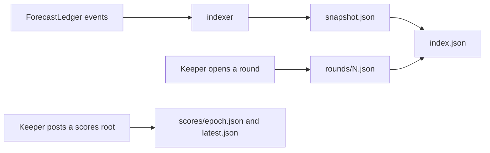

# Published data files

The site is static. Every number it shows comes from a few JSON files, rebuilt from BSC events after each keeper run. You can read them directly.

Base URL: `https://forewit.xyz/data/` (fallback `https://forewit.pages.dev/data/`).

## What you will have at the end

* You know which file to fetch for rounds, scores and proofs, and what each field means.

## Steps

1. Fetch `index.json` to find the snapshot and the round files.
2. Fetch `snapshot.json` for onchain state and metrics.
3. Fetch `rounds/<id>.json` for question texts.
4. Fetch `scores/latest.json` for Merkle proofs, once a root exists.

Numbers that can exceed 2^53 (round ids, block numbers, sums) are decimal strings. Addresses in maps are lowercase.

## `index.json` (manifest)

* `sample`: false for live data.
* `network`: 56 for BSC mainnet.
* `ledger`: the ForecastLedger address.
* `publishedAt`: ISO time of the publish.
* `note`: a short human note.
* `snapshot`: path of the snapshot, `snapshot.json`.
* `rounds`: paths of the round files, for example `rounds/1.json`.

## `snapshot.json`

Built by [`indexer/build.mjs`](https://github.com/owaisahmad870/forewit/blob/main/indexer/build.mjs) from ForecastLedger events only, and published with the round files by [`indexer/publish.mjs`](https://github.com/owaisahmad870/forewit/blob/main/indexer/publish.mjs).

* `network`, `ledger`, `agentId`: chain id and the two contracts.
* `builtAt`, `headBlock`: when and up to which block it was built.
* `metrics`:
  * `distinctCommitters`: distinct wallets that committed.
  * `rounds`: number of rounds.
  * `perDay`: commits and reveals per UTC day.
  * `windowMove`: the average market move, in percentage points, between the baseline snapshot and the commit deadline over the first 5 rounds (`rounds`, `avgPts`, `thresholdPts` 0.5, `active`). It watches the bounded "last look" risk.
* `rounds`: one entry per round:
  * `roundId`, `createdBlock`, `commitDeadline`, `revealDeadline`, `resolutionWait` (seconds).
  * `questions`: `conditionId`, `ctf`, `yesSlot`, `marketId`.
  * `committers`, `revealed`: wallet lists.
  * `forecasts`: revealed packed forecasts by wallet.
  * `scored`, `forfeited`: per wallet sums `{questions, brier, skill}`.
  * `outcomes`: per question `Unresolved`, `Yes`, `No` or `Void`.
  * `baseline`: the packed market baseline, or null if none was posted.
  * `crowd`: the Agent ID Crowd forecast `{method, bps}`, or null.
  * `commitTiming`: per wallet `{at, afterBaseline, gapSec}`.
  * `flags`: round flags such as `baseline_missing`.
  * `commitCount`, `revealRate`.
* `profiles`: wallets that set a profile, `{isPublic, name}`. Only opt in names appear.
* `operators`: keeper, admin and pauser wallets. They are never ranked.
* `identityChanged`: committers whose Agent ID left their wallet after the ledger went live.
* `firstCommits`: each wallet's first commit `{tx, roundId, block}`, used by the proof page to count distinct holders.

## `rounds/<id>.json`

Written by the keeper when it opens a round. The CLI's `--round-file` reads this file and cross checks it against the chain.

* `network`, `ledger`, `roundId`, `kind` (`daily`), `rule` (the selection rule, for example `QUESTION_SELECTION v3.1`).
* `commitDeadline`, `revealDeadline`, `resolutionWaitSeconds`.
* `marketPriceAt`, when present: when the market prices below were read.
* `windowMovePts`, when present: the market move between the baseline snapshot and the deadline for this round.
* `questions`, in order:
  * `index`, `marketId`, `conditionId`, `ctf`.
  * `eventQuestion` and `label`: always shown together as "event question · label".
  * `marketQuestion`, `endsAt`, `tags`.
  * `marketPrice`, when present: the latest published price before the deadline, 0 to 1.

Question texts come from Predict.fun. Treat them as untrusted text.

## `scores/<epoch>.json` and `scores/latest.json`

Written by the keeper after each ForewitScores root. **None exists yet**: no root had been posted as of 24 Nov 2026. The shape below comes from `leavesFile` in [`indexer/scores.mjs`](https://github.com/owaisahmad870/forewit/blob/main/indexer/scores.mjs).

* `chainId`, `ledger`, `scores`, `agentId`.
* `epoch`, `roundId`, `snapshotBlock`.
* `method`: `forewit scores v1: skill = sumSkill / (baselineQuestions + 20), truncated toward zero`.
* `root`, `leafCount`.
* `leaves`: `{tokenId, forecaster, skill, n, proof}`. Only holders who opted in publicly with their name.
* `excluded`: `{forecaster, reason}` with reason `operator`, `not_public` or `moved`. Never a tokenId.

If a file is lost, anyone can rebuild it from logs. See [Recompute any score or root](recompute.md).

## Typed access

The site's own loader and types are in [`web/src/lib/data.ts`](https://github.com/owaisahmad870/forewit/blob/main/web/src/lib/data.ts). It joins these files into rounds, questions and leaderboard rows, so you can reuse its logic.
