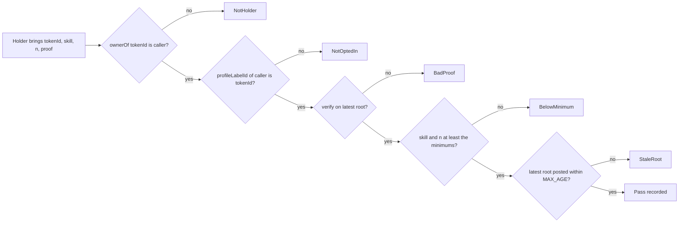

# Gate on a Forewit score

Forewit posts one Merkle root of every opted in Agent ID's score to [ForewitScores](https://bscscan.com/address/0xb668BCC3cC103538d5B8e8c3F18B6E36a7dB0Fdc). Anyone can prove a score against that root with one view call. You can use it to give something only to forecasters with real, proven skill: a badge, an allowlist, a role.




No root is posted yet. `latestEpoch()` read 0 on 24 Nov 2026, so `verify` returns false for everyone until the first round settles with at least one opted in holder. The posting path is built and tested but not yet exercised on mainnet.


## What you will have at the end

* An offchain check (one `eth_call`) that tells you whether a holder's published score is proven onchain.
* The exact order of checks to copy into your own contract.

## The score in one paragraph

A leaf is `(uint256 tokenId, int256 skill, uint256 n)`. `tokenId` is the Agent ID token, `uint256(keccak256(bytes(label)))` with the name written without `.ai`. `n` is the number of questions scored against the market baseline. `skill` is `sumSkill / (n + 20)`, truncated toward zero, in bps squared per question (1 unit is 1/1e8 of Brier). Positive skill means the forecaster beat the market price on average. Only holders who opted in publicly with their name get a leaf. See [Scoring](../how_it_works/scoring.md) and [ForewitScores](../how_it_works/forewit_scores.md).

## Steps (offchain check with viem)

1. Fetch the leaves file the keeper publishes after each root: `https://forewit.xyz/data/scores/latest.json` (or the same path on `forewit.pages.dev`). It does not exist until the first root is posted. See [Published data files](data_files.md).
2. Find the holder's leaf by `tokenId`.
3. Call `verify` on ForewitScores, and check that the wallet you are serving owns the token.

```js
import { createPublicClient, http, parseAbi, keccak256, toBytes } from 'viem';
import { bsc } from 'viem/chains';

const SCORES = '0xb668BCC3cC103538d5B8e8c3F18B6E36a7dB0Fdc';
const AGENT_ID = '0x60B9262456dE011F7d15a54CdD8c48bAaa8B022F';
const abi = parseAbi([
  'function verify(uint256 tokenId, int256 skill, uint256 n, bytes32[] proof) view returns (bool)',
  'function latestEpoch() view returns (uint256)',
  'function ownerOf(uint256 tokenId) view returns (address)',
]);
const client = createPublicClient({ chain: bsc, transport: http('https://bsc-rpc.publicnode.com') });

const tokenId = BigInt(keccak256(toBytes('alice'))); // Agent ID name without ".ai"
const file = await (await fetch('https://forewit.xyz/data/scores/latest.json')).json();
const leaf = file.leaves.find((l) => BigInt(l.tokenId) === tokenId); // no leaf: not opted in, or no root yet

const proven = leaf !== undefined && await client.readContract({
  address: SCORES, abi, functionName: 'verify',
  args: [tokenId, BigInt(leaf.skill), BigInt(leaf.n), leaf.proof],
});
// ownerOf reverts for a name nobody holds
const owner = await client.readContract({ address: AGENT_ID, abi, functionName: 'ownerOf', args: [tokenId] }).catch(() => null);
console.log({ proven, owner, skill: leaf?.skill, n: leaf?.n });
```

A proof is public. Anyone can copy it. Always bind it to the wallet you are serving, as the gate below does.

## The onchain checks, in order

[`ForewitGate`](https://github.com/owaisahmad870/forewit/blob/main/contracts/src/examples/ForewitGate.sol) is an example consumer in the repository. It is not deployed by Forewit. Its constructor takes `(ForewitScores scores, int256 minSkill, uint256 minN, uint256 maxAge)` and reads `AGENT_ID` and `LEDGER` from ForewitScores. `claim(tokenId, skill, n, proof)` checks:

1. `AGENT_ID.ownerOf(tokenId) == msg.sender`, else `NotHolder`. Proofs are public, so the caller must own the token.
2. `LEDGER.profileLabelId(msg.sender) == tokenId`, else `NotOptedIn`. The caller must be the wallet that opted in this name on ForecastLedger. This narrows a reissued name.
3. `SCORES.verify(tokenId, skill, n, proof)`, else `BadProof`. It checks only the latest root, and fails if that root is revoked. It never falls back to an older root.
4. `skill >= MIN_SKILL` and `n >= MIN_N`, else `BelowMinimum`. Set `MIN_SKILL` clearly above 0, for example 1,000,000 (about 0.01 Brier per question). The baseline is public before the deadline, so a wallet that copies it scores exactly 0 on every question; with `MIN_SKILL` 0 it would pass with no risk taken. `n` counts questions, not risk. The leaderboard uses at least 20 questions.
5. `block.timestamp <= SCORES.getEpoch(latestEpoch).postedAt + MAX_AGE`, else `StaleRoot`. This bounds how old the root may be (for example 3 days).

Then it records `passed[tokenId] = epoch` and emits `Passed`.

## Known limits

* `MAX_AGE` measures when the root was posted, not how old its snapshot is (review I2).
* A recorded pass survives a later revoke of that root. If that matters, recheck `getEpoch(epoch).revoked` (review I1).
* A reissued name can carry the previous holder's score until the next root, if the new owner opts in that name. See [Threat model and accepted risks](../trust/threat_model.md).
* Use `verify` (latest root only). `verifyAt` on an older epoch stays true by design, so accepting a caller chosen epoch lets holders pick their best old score.

Source: [`contracts/src/ForewitScores.sol`](https://github.com/owaisahmad870/forewit/blob/main/contracts/src/ForewitScores.sol), [`docs/SCORES.md`](https://github.com/owaisahmad870/forewit/blob/main/docs/SCORES.md) section 6. Full function list: [Contract reference: ForewitScores](forewit_scores_reference.md).
