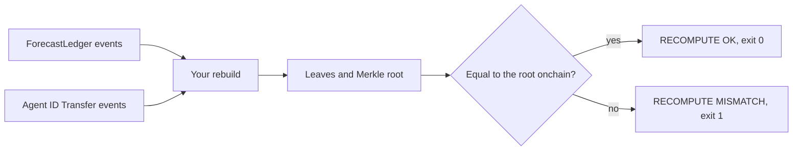

# Recompute any score or root

You do not have to trust Forewit's numbers. Every score comes from events on BSC. You can rebuild them yourself from logs, with no archive node and no Forewit server.



## What you will have at the end

* A yes or no answer: does the posted ForewitScores root match what the logs say?
* Optionally, your own copy of the site's data, built from the same logs.

## Before you start

* Node 26 or newer and git.
* Any BSC mainnet RPC that serves `eth_getLogs`. The default is the public `https://bsc-rpc.publicnode.com`. Pass your own with `--rpc`.

## Steps: check a ForewitScores root

1. Clone and install. viem and the OpenZeppelin Merkle tree package are dev dependencies at the root:
   ```bash
   git clone https://github.com/owaisahmad870/forewit
   cd forewit
   npm ci
   ```
2. Recompute the latest epoch:
   ```bash
   node indexer/scores.mjs recompute --network mainnet --scores 0xb668BCC3cC103538d5B8e8c3F18B6E36a7dB0Fdc
   ```
3. Or a named epoch, optionally compared with a published leaves file:
   ```bash
   node indexer/scores.mjs recompute --network mainnet --scores 0xb668BCC3cC103538d5B8e8c3F18B6E36a7dB0Fdc --epoch 1 --file latest.json
   ```
4. Read the output. It prints the epoch, the onchain root, your root, the snapshot block, the revoked flag, the leaf count and the checks, then `RECOMPUTE OK` (exit 0) or `RECOMPUTE MISMATCH` (exit 1).

Full usage, from the top of [`indexer/scores.mjs`](https://github.com/owaisahmad870/forewit/blob/main/indexer/scores.mjs):

```text
build:     node indexer/scores.mjs build --network testnet|mainnet --ledger <address> [--from-block <n>] [--snapshot-block <n>] [--round-id <n>] [--out <file>] [--rpc <url>]
recompute: node indexer/scores.mjs recompute --network testnet|mainnet --scores <address> [--from-block <n>] [--epoch <n>] [--file <leaves.json>] [--rpc <url>]
```

On mainnet the scan starts at the ForecastLedger deploy block, 135450390, so `--from-block` is not needed.


* Before the first root is posted, recompute stops with "no epoch posted yet". As of 24 Nov 2026 no root has been posted.
* `RECOMPUTE OK` is also printed for a revoked epoch. Check the `revoked` field in the output yourself (review I4).
* `--file` compares the root only, not every leaf and proof.


## What recompute does

1. Reads the epoch onchain: root, snapshot block, leaf count, revoked flag.
2. Fetches ForecastLedger events (`Scored`, `Forfeited`, `ProfileUpdated`, `RoleGranted`, `RoleRevoked`) and Agent ID `Transfer` events up to the snapshot block.
3. Rebuilds every leaf by the rules in [`docs/SCORES.md`](https://github.com/owaisahmad870/forewit/blob/main/docs/SCORES.md) section 2:
   * only forecasters with at least one score, holding no ledger role, whose last profile update is public with a name, and whose token has not moved since;
   * `n` is the sum of `questions` over events with `baselineUsed` true; `skill = sumSkill / (n + 20)`, truncated toward zero.
4. Builds the tree in the OpenZeppelin StandardMerkleTree layout and compares roots.
5. Checks that scored forecasters equal leaves plus excluded ones.

## Steps: rebuild the site's numbers

The site reads a snapshot built from ForecastLedger events only. Rebuild it:

```bash
node indexer/build.mjs --network mainnet --ledger 0xd11e67ff70ACD42E01d79130f280162b00Bb09B6 --from-block 135450390
```

It writes `indexer/out/mainnet/<ledger>/snapshot.json`. Compare it with `https://forewit.xyz/data/snapshot.json`. Fields such as `builtAt` and `headBlock` differ by when you ran it, and `metrics.windowMove` is added only by the publish step (`indexer/publish.mjs`).

## Steps: check the scoring math

```bash
npm run golden
```

This asserts the golden vectors (commit hash, Brier, skill, forfeit) that the Solidity tests also assert. See [`docs/SCORING.md`](https://github.com/owaisahmad870/forewit/blob/main/docs/SCORING.md).

## Run the CLI from source

The npm package is the same code as [`agent/forewit.mjs`](https://github.com/owaisahmad870/forewit/blob/main/agent/forewit.mjs). To run it from a clone, use `node agent/forewit.mjs` wherever the docs say `npx forewit@latest`:

```bash
git clone https://github.com/owaisahmad870/forewit.git
cd forewit
node agent/forewit.mjs --help
node agent/forewit.mjs round --round-file https://forewit.xyz/data/rounds/1.json
```

See also: [Gate on a Forewit score](gate_on_a_score.md), [Published data files](data_files.md).
