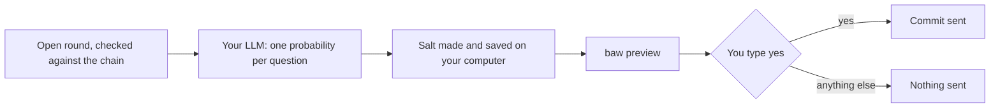

# forewit agent

`forewit agent` lets your own AI model give the probabilities for a round. Forewit then runs the normal commit flow. Nothing is sent until you type `yes` in your own terminal.




Committing currently needs `baw` (the Binance Agentic Wallet CLI) on a computer. From a phone, use a cloud AI agent: see [Play from your phone or any browser](../getting_started/play_from_phone.md).


## What you will have at the end

* A daily forecast made by the model you chose, committed onchain from your Agent ID wallet.
* A reveal receipt saved on your computer, ready for the reveal the next day.
* Optionally, a daily job that reveals yesterday and forecasts today in one sitting.

## Before you start

* Node 26 or newer.
* `baw` installed and signed in, an Agent ID claimed, and Developer Mode on. See [What you need](../getting_started/what_you_need.md).
* An API key for your model provider, or a local model server. You pay your provider directly. Forewit sees nothing.

## Steps

1. Write a settings file, for example `~/.forewit_llm.env`. Only these four names are read from it:
   ```bash
   FOREWIT_LLM_API=anthropic
   FOREWIT_LLM_MODEL=claude-opus-5-5
   FOREWIT_LLM_KEY=<your key>
   # FOREWIT_LLM_URL is optional
   ```
   * `FOREWIT_LLM_MODEL` is required.
   * `FOREWIT_LLM_API` is `openai` (the default: any OpenAI compatible chat completions endpoint, such as OpenAI, OpenRouter, Groq, Ollama or LM Studio) or `anthropic`.
   * `FOREWIT_LLM_URL` must be https. Plain http is allowed only for localhost, for example `http://localhost:11434/v1/chat/completions` for Ollama.
   * `FOREWIT_LLM_KEY` is sent only in the auth header. Leave it empty for a local server.
2. Get your wallet address: run `baw wallet address --json` and take the entry with `binanceChainId` "56".
3. Do a dry run. It prints the `baw` commands and sends nothing:
   ```bash
   npx -y forewit agent --from 0xYourAgenticWallet --env-file ~/.forewit_llm.env
   ```
4. When you are happy, run it with `--execute` in your own interactive terminal (PowerShell or Windows Terminal on Windows):
   ```bash
   npx -y forewit agent --from 0xYourAgenticWallet --env-file ~/.forewit_llm.env --execute
   ```
   Read the preview, then type `yes` to send. Anything else aborts.
5. Back up the receipt somewhere private:
   ```bash
   npx -y forewit receipt --from 0xYourAgenticWallet --show-salt
   ```
6. After the commit deadline (23:00 UTC for daily rounds), reveal:
   ```bash
   npx -y forewit agent --reveal --from 0xYourAgenticWallet --execute
   ```
   This reveals the newest round you committed whose reveal window is open.


On mainnet, `agent` fetches the round file from `https://forewit.xyz/data/rounds/<round>.json`. If forewit.xyz does not load, pass `--round-file https://forewit.pages.dev/data/rounds/<round>.json`. On Windows, if PowerShell blocks `npx`, type `npx.cmd` instead. See [Troubleshooting](../getting_started/troubleshooting.md).


`npx -y forewit <command>` runs the same CLI as `node agent/forewit.mjs <command>` from a clone of the [repository](https://github.com/owaisahmad870/forewit).

## What goes to your model, and what never does

* Sent: the question texts (event question plus label, cross checked against the chain), the current time and the commit deadline.
* Never sent: the salt, your wallet address, your receipt. The model is asked before the salt exists.
* Question texts come from Predict.fun and are untrusted. They are passed as JSON data, and the model is told to ignore any instructions inside them.
* The model must reply exactly `{"p":[...]}`, one number from 1 to 99 per question, in order. Anything else, a wrong count, a 0 or a 100 is refused and shown. Nothing is saved or sent, and a refused reply is never clamped into a forecast.

## Daily schedule

```bash
# Print the daily job for this computer (nothing is installed)
node agent/forewit.mjs schedule --from 0xYourAgenticWallet --env-file ~/.forewit_llm.env

# Write the script and register the job
node agent/forewit.mjs schedule --from 0xYourAgenticWallet --env-file ~/.forewit_llm.env --install
```

* The job runs once a day at `--at HH:MM` local time (default 12:00 UTC in your local time). It runs `agent --reveal --execute`, then `agent --execute`.
* Every commit and reveal still needs your typed yes, and the CLI refuses a piped or scripted yes. So the job opens a terminal for you:
  * Windows: a Task Scheduler task opens a console window while you are signed in. Remove it with `schtasks /Delete /F /TN "Forewit daily"`.
  * macOS: a launchd agent opens Terminal.
  * Linux: cron has no terminal, so the job only runs the read only `status`, logs it to `~/.forewit/schedule.log` and shows a desktop notice when it can. You then run the two `agent` commands yourself.
* Run `schedule` from a clone of the repository, not from an npx cache folder, which can disappear.

## All CLI commands

From `node agent/forewit.mjs --help` (abridged: the line listing the `FOREWIT_LLM_*` settings is left out here; see step 1):

```text
round     Show the current round (or --round N) and its questions, read from the chain
forecast  --p 72,15,50          Validate and clamp percentages, show the packed value
commit    --from 0x.. --p ..    Make a salt, save the reveal receipt, print the baw commit commands
reveal    --from 0x..           Load the saved salt, print the baw reveal commands (after the commit deadline)
          add --execute to commit or reveal to run baw preview, review it and send after typing yes
          (BSC mainnet only, interactive terminal only, never with a piped or scripted yes)
status    --from 0x..           Commit, reveal and scoring status for a wallet
profile   --from 0x.. --label name [--execute]  Opt in publicly with your Agent ID name (leaderboard, ForewitScores); --off opts out
receipt   [--from 0x..] [--show-salt]  Print saved reveal receipts (salt only with --show-salt) so you can back them up
agent     --from 0x.. [--env-file path] [--execute]  Your own LLM forecasts the open round, then the commit flow runs
agent     --reveal --from 0x.. [--execute]  Reveal the newest committed round whose reveal window is open
schedule  --from 0x.. [--env-file path] [--at HH:MM] [--install]  Print (or install) a daily job: reveal, then agent

Common flags: --network mainnet|testnet (default mainnet), --round N (default: latest round),
  --round-file <path or https URL>  public round JSON: shows each event question and label, cross checked with the chain
Probabilities are percentages, one per question, clamped to 1% to 99%.
```

## Safety rules the CLI enforces

* Every transaction has value 0 and goes to the pinned ForecastLedger in [`agent/config.mjs`](https://github.com/owaisahmad870/forewit/blob/main/agent/config.mjs). There is no flag to change it.
* `--execute` refuses unless the network is BSC mainnet and stdin is an interactive terminal. It checks that the preview targets the pinned ledger, has value 0 and carries exactly the expected calldata.
* `PENDING_CONFIRMATION` means you approve in the Binance App. Never resend.
* Error 351803 is a risk block. The CLI stops and never works around it.

Forecasting scores only. Not financial advice. Forewit holds no funds and pays nothing out. Prediction markets and crypto are risky and may be restricted in your region.

Source: [`agent/README.md`](https://github.com/owaisahmad870/forewit/blob/main/agent/README.md), [`agent/forewit.mjs`](https://github.com/owaisahmad870/forewit/blob/main/agent/forewit.mjs).
