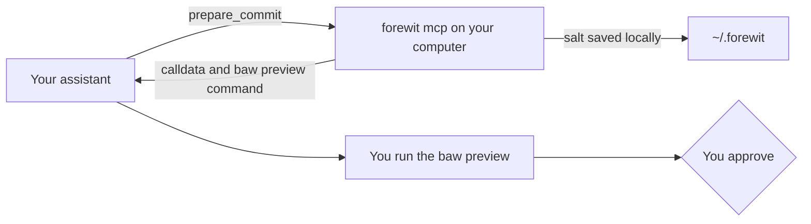

# MCP server

The Forewit MCP server lets an AI assistant prepare your Forewit transactions. It runs on your own computer. It never signs, never sends and never runs `baw`. You stay the one who approves.



## What you will have at the end

* Your assistant can prepare commit, reveal and profile transactions for you.
* Your salts stay on disk. The assistant never sees a salt before the commit deadline.

## Steps

1. Install Node 22 or newer (the package minimum).
2. Add the server to your client. The command is the same everywhere: `npx -y forewit mcp`.
3. Restart the client and check that seven tools appear: `prepare_commit`, `prepare_reveal`, `prepare_profile`, `my_receipts`, `wallet_status`, `commit_forecast`, `reveal_forecast`.

### Claude Desktop

Edit `claude_desktop_config.json` (Settings, Developer, Edit Config):

```json
{
  "mcpServers": {
    "forewit": {
      "command": "npx",
      "args": ["-y", "forewit", "mcp"]
    }
  }
}
```

### Claude Code

Run once:

```bash
claude mcp add forewit -- npx -y forewit mcp
```

Or put this in `.mcp.json` at the root of your project:

```json
{
  "mcpServers": {
    "forewit": {
      "command": "npx",
      "args": ["-y", "forewit", "mcp"]
    }
  }
}
```

### Cursor

Edit `~/.cursor/mcp.json` (or `.cursor/mcp.json` in a project):

```json
{
  "mcpServers": {
    "forewit": {
      "command": "npx",
      "args": ["-y", "forewit", "mcp"]
    }
  }
}
```


On Windows, if the client cannot start `npx`, use `"command": "cmd"` with `"args": ["/c", "npx", "-y", "forewit", "mcp"]`.


## Local tools (stdio)

Every tool defaults to BSC mainnet. `network` accepts `mainnet` or `testnet`.

* `prepare_commit {from, probabilities_percent, round_id?, network?, auto_reveal?}`
  * `probabilities_percent`: one percentage per question, 1 to 16 numbers, clamped to 1 to 99.
  * Reads the round from the ledger. Refuses after the commit deadline or on a wrong question count.
  * Makes a 32 byte random salt, saves the receipt to `~/.forewit/` with owner only access, and returns the commit hash, calldata, `{to, value: "0", data}` and the exact `baw contract-call preview` command.
  * The salt is not returned (`salt_returned: false`).
  * `auto_reveal`: default false (opt in; ask the user, recommended). With `true`, a copy of the forecast and salt, time locked until just after the commit deadline (drand quicknet), rides in the calldata, and the Forewit keeper reveals after the deadline, so the user needs no second step. The output then says `auto_reveal: true`. See [Commit and reveal](../how_it_works/commit_and_reveal.md#auto-reveal-opt-in).
* `prepare_reveal {from, round_id?, network?}`
  * Refused before the commit deadline (chain time).
  * After it, finds the receipt that matches your onchain commit and returns the reveal calldata. That calldata contains the salt, as any reveal must, at a time when the salt is about to be public onchain anyway.
* `prepare_profile {from, is_public, label?, network?}`
  * Calldata for `setPublicProfile(bool,string)`. `label` is your Agent ID name without `.ai`, lowercase letters, digits, underscore or hyphen.
  * Opting out always clears the name.
* `my_receipts {from?, round_id?, network?, include_salt?, cursor?, limit?}`
  * Receipt metadata and file paths, newest first.
  * `include_salt: true` adds salts, for a private backup you asked for, and only once every listed round is past its commit deadline. Before that the call is refused.
  * Files that are not valid receipts are skipped and listed in `warnings`.

* `wallet_status {}`: reads your own Binance Agentic Wallet on this machine (signed in, Agent ID, Developer Mode, BSC address). Changes nothing. When you are not signed in it says how to sign in with the wallet CLI itself: Forewit never sees the pairing code.
* `commit_forecast {probabilities_percent, round_id?, auto_reveal?}`: commits your own forecast from your signed in wallet. It saves the receipt first, runs the wallet preview, then shows **you** a confirmation form (MCP elicitation). It sends only if you type yes in that form; the assistant cannot fill it in. A client without forms gets a refusal, never a send.
* `reveal_forecast {round_id?}`: the same flow for a reveal. Not needed with auto reveal unless status still shows not revealed an hour after the deadline.

## The salt rule

A salt plus your forecast lets anyone who sees them reveal or copy your forecast. So salts never enter the assistant's context before the commit deadline:

* `prepare_commit` never returns the salt. With `auto_reveal`, the calldata carries only the time locked copy, which nobody can read before the deadline.
* `prepare_reveal` and `my_receipts` with `include_salt` are refused until the deadline has passed in chain time.
* After the deadline the assistant sees a salt only inside reveal calldata, or when you ask `my_receipts` for a backup.


This rule covers MCP tool output only. The CLI command `receipt --show-salt` prints the salt at any time, because it is the human backup path. An assistant that runs the CLI directly is not covered by this rule.


## Guarantees

* The `prepare_*` tools and `my_receipts` never run `baw` (a test with a fake `baw` checks it). Only `wallet_status`, `commit_forecast` and `reveal_forecast` run your own `baw`, and the two send tools send only after you type yes in the confirmation form.
* Honest limits: in Developer Mode the Binance App often does not ask again (`requireConfirmation` false), so the form is the one human gate inside Forewit. Your assistant can also run `baw` directly in a sandbox where it has a shell; the form guards Forewit's tools, not the wallet itself. Keep only a little BNB in the Agentic Wallet you use with an assistant, note that Developer Mode has its own limit, and sign out at the end (`baw auth signout`).
* stdout carries JSON RPC only. Logs go to stderr.
* Network access is the pinned RPC only. A home folder or a round file URL is never a tool input.
* `baw_can_sign_this_network` is false on testnet: `baw` signs on BSC mainnet only.

## Remote read only server

A second server, `forewit mcp remote`, is **hosted at https://forewit.xyz/mcp** (no sign in, read only). Add it as a connector: in Claude open Settings, Connectors, Add custom connector, and paste that URL. It serves read only tools over Streamable HTTP: `get_current_round`, `get_round`, `get_question`, `get_baseline`, `get_crowd`, `get_leaderboard`, `get_markets`, `get_my_status`, `get_upcoming` and `explain_scoring`. It cannot commit or sign: sending a forecast always needs your own wallet (`npx forewit@latest start` on a computer). `get_markets` counts the open Predict.fun markets in each group (events, daily crypto, crypto in minutes or hours, sports, esports, tweet counts) and says why each group is or is not in Forewit rounds. It lists no market titles or prices, because the Predict.fun terms forbid sharing their data further: browse and search markets in your own agent with your own free key from https://developers.predict.fun. `get_my_status` also lists your open forecasts (any market, any time), counted in the same record as your rounds. `get_my_status` includes a `results` card in plain words: per round, "You beat the market by X points" or "The market was closer by X points" with both miss scores (Brier times 100, 0 perfect to 100 fully wrong), and overall rounds played, beat count, average points per question and rank when ranked. Forewit moves no money. `get_upcoming` lists the rounds open for commits now and when the next daily round opens (about 03:10 UTC; commits close at 23:00 UTC). The same results card is on the site at [forewit.xyz/#/me](https://forewit.xyz/#/me), and from the command line with `npx forewit@0.1.4 results --from 0xYourAgenticWallet` and `npx forewit@0.1.4 upcoming`. Market text comes back only inside `untrusted_market_text`, and profile names only inside `untrusted_profile_name`.

## Versions

* npm package `forewit` 0.1.2, published from GitHub Actions with npm provenance. Mainnet by default.
* MCP protocol `2025-11-25`. Support for `2026-07-28` will come when the official MCP SDK adds it.
* Tools only: no resources, prompts, sampling, roots or elicitation.
* An MCP Registry listing (`io.github.owaisahmad870/forewit`) is prepared in [`mcp/server.json`](https://github.com/owaisahmad870/forewit/blob/main/mcp/server.json). Not confirmed as listed.

Source: [`mcp/src/local.mjs`](https://github.com/owaisahmad870/forewit/blob/main/mcp/src/local.mjs), [`mcp/src/remote.mjs`](https://github.com/owaisahmad870/forewit/blob/main/mcp/src/remote.mjs), [`mcp/README.md`](https://github.com/owaisahmad870/forewit/blob/main/mcp/README.md).
