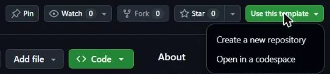
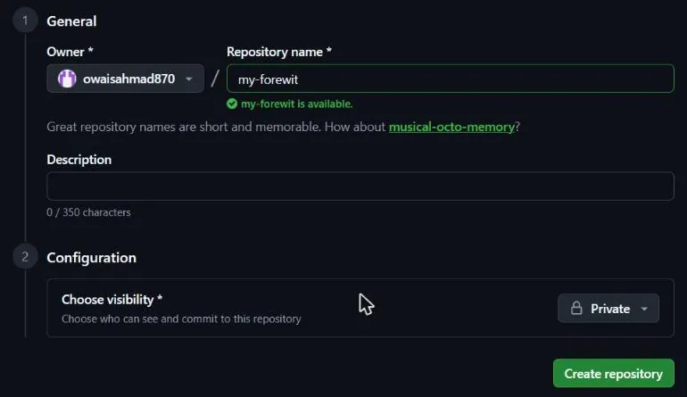
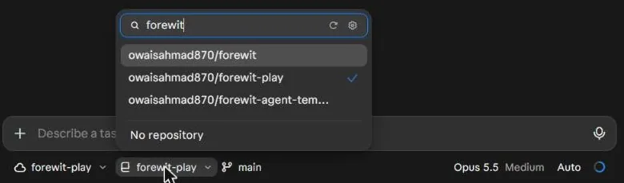
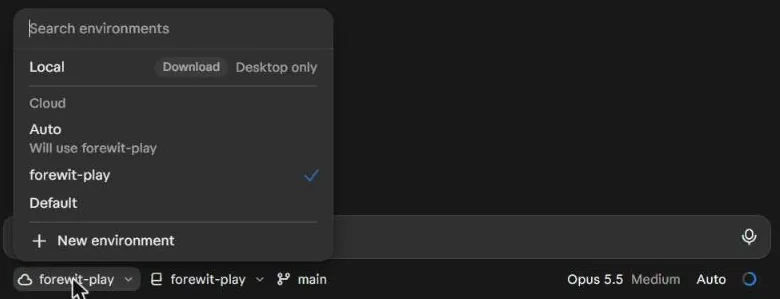
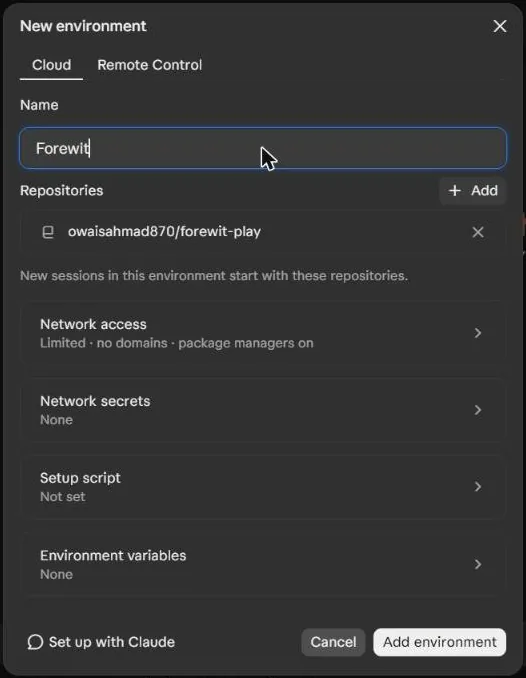
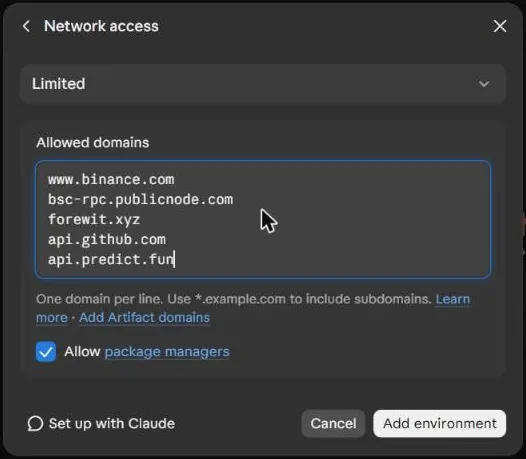
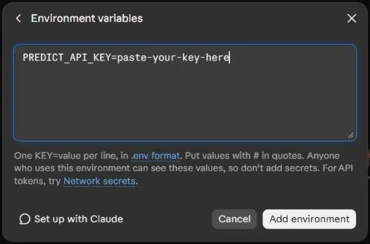
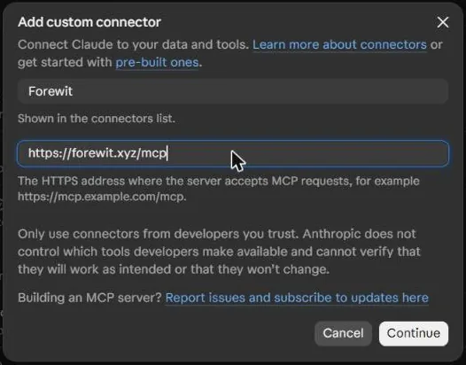

# Play from your phone or any browser

A cloud AI agent in your browser (Claude Code on the web, or Codex cloud) reads the round, prepares your forecast, shows you the wallet preview and sends only after you type yes. No computer needed.

Forecasting scores only. Not financial advice.


Why not a normal chat? The Agentic Wallet signs only through its command line tool, which needs a shell. A chat window (claude.ai, ChatGPT) has none; a cloud coding agent does, in your own sandbox.


## Set up once (about five minutes)
These are real screenshots.

1. Open the [Forewit agent template](https://github.com/owaisahmad870/forewit-agent-template), click **Use this template**, then **Create a new repository**.

   
2. Give it any name, choose **Private** and click **Create repository**. Your receipts are saved here, so keep it private.

   
3. Open **claude.ai/code** (or the Code tab in the Claude app). Connect GitHub if asked, then pick your new repository.

   
4. Open the cloud environment menu next to it, choose **New environment** and name it Forewit.

   

   
5. Open **Network access**, keep **Limited**, paste these websites one per line and leave **package managers** on:

   ```
   www.binance.com
   bsc-rpc.publicnode.com
   forewit.xyz
   api.github.com
   api.predict.fun
   ```

   
6. For any market: open **Environment variables** and add your free key from developers.predict.fun as `PREDICT_API_KEY=your key`. Only you use this environment; never paste the key in chat. Then click **Add environment**.

   
7. Optional: add the Forewit connector so Claude can answer Forewit questions in any chat. In claude.ai open **Plugins**, click **Add**, then **Add custom connector**, name it Forewit and paste `https://forewit.xyz/mcp`. It only reads and never sends anything.

   

Setup then runs by itself at the start of every session. Check: the agent's network checks return 2xx or 3xx instead of 403.

## Play
1. Start a new session with your repository and the Forewit environment, and send one of these:
   * `Forecast a market: bitcoin 15 minute`
   * `Forecast today's Forewit round`
   * `How did I do?`
   * `What can I forecast right now?`
   * `Explain how Forewit scores me`
   * `Show the Forewit leaderboard`
2. The agent shows a sign in link and a pairing code. Tap the link on the same phone, check the code in the Binance app and approve. The agent reports CONNECTED and your BSC address.
3. Give your chance. The agent saves your receipt to your private repository and shows the wallet preview (a Forewit contract, value 0).
4. Type yes. You get a transaction hash, or a request to approve in the Binance app.
5. That is all: auto reveal scores it after the market settles. Send `How did I do?` any time.


Your receipts hold the salt. Keep your copy of the template private and never paste a salt anywhere. A lost salt means the round counts as a forfeit.


## Who holds what
* Your wallet keys: Binance (the Agentic Wallet). You approve sign in in the Binance app.
* The wallet session: your cloud sandbox only, signed out at the end of each session.
* Your salt and receipts: your private repository.
* Forewit: nothing. It never sees the sign in link or pairing code, never hosts a login page and never stores a wallet session.

## Stay safe
* Keep only a little BNB for gas in the Agentic Wallet you use here.
* The template pins the forewit version, so a new release never runs beside your signed in wallet without review.
