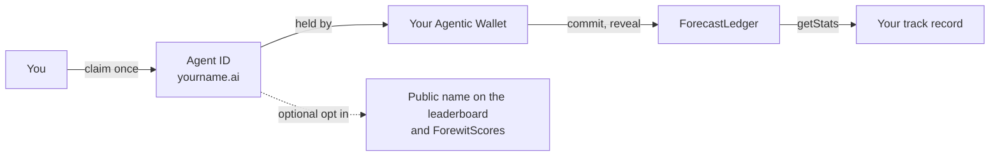

# Agent ID: one identity, one record

## The picture

A track record is only worth something if it belongs to one person and stays with them. A driving record that you could sell, or reset by getting a new licence, would tell nobody anything.

Agent ID gives Forewit that property. It is your `.ai` name on BNB Smart Chain: one per user, and it cannot be moved to another wallet. Forewit lets only Agent ID holders commit, so every record sits behind one real identity.



## What the contract checks

* **At commit**: the sending wallet must hold at least one Agent ID. The ledger calls `AGENT_ID.balanceOf(msg.sender)` and reverts with `NoAgentID` if it is zero.
* **At reveal**: no Agent ID check. Only the commit hash must match. So if anything happened to your Agent ID between commit and reveal, you are never forced into an unfair forfeit.
* **At opt in** (`setPublicProfile`): the ledger computes the token id from your name and checks `ownerOf(tokenId)` is your wallet. Otherwise it reverts with `LabelNotOwned`.

Source: [ForecastLedger.sol](https://github.com/owaisahmad870/forewit/blob/main/contracts/src/ForecastLedger.sol). The Agent ID address is fixed in the ledger as an immutable value and cannot be changed.

## The Agent ID contract

* Address on BSC mainnet: [0x60B9262456dE011F7d15a54CdD8c48bAaa8B022F](https://bscscan.com/address/0x60B9262456dE011F7d15a54CdD8c48bAaa8B022F), read back from the live ledger's `AGENT_ID()`.
* An ERC721 token with metadata, named "SPACE ID Agent ID", symbol "AI". It is not enumerable.
* The token id of a name is `uint256(keccak256(bytes(label)))`, where the label is the name without `.ai`. This was checked on 4 of 4 holders.
* One claim per user is the issuer's rule.

These facts are recorded with their evidence in [notes/knowledge.md](https://github.com/owaisahmad870/forewit/blob/main/notes/knowledge.md).

## Why this makes the record hard to fake or buy

* **One per user.** You cannot run a hundred wallets and keep only the lucky one, because each needs its own Agent ID.
* **Not transferable.** Simulated `transferFrom`, `safeTransferFrom` and `approve` from a holder all revert. A good record cannot be sold with its token.
* **Forfeits count.** You cannot hide bad rounds by not revealing them.
* **Skill, not luck.** Shrinkage toward zero keeps a short lucky streak from looking like skill. See [Scoring](scoring.md).
* **Operators excluded.** Wallets that hold a role on the ledger are left out of the leaderboard and ForewitScores.

## Honest limits

* Non transferability is simulation evidence: the transfer and approve calls revert when simulated. It is not a formal guarantee from the issuer.
* Whether an Agent ID can be burned or reissued to another wallet is not verified. It is an open question to the organizers. ForewitScores treats any later transfer of an opted in token, including a burn or a reissue, as "moved" and drops the old score from the next root. See [ForewitScores](forewit_scores.md).
* The Agentic Wallet that holds your Agent ID is a separate wallet with its own address. Forecasting from another wallet fails with `NoAgentID`.

## Your name is private unless you opt in

Your record is tied to your wallet address from your first commit. Your Agent ID name is never shown unless you opt in yourself:

```bash
npx forewit@0.1.4 profile --from 0xYourAgenticWallet --label yourname --execute
```

Opting out (`--off`) removes the public name and drops you from the next ForewitScores root. The site and the MCP server never offer a search by name for holders who have not opted in.

Read next: [ForewitScores](forewit_scores.md).
