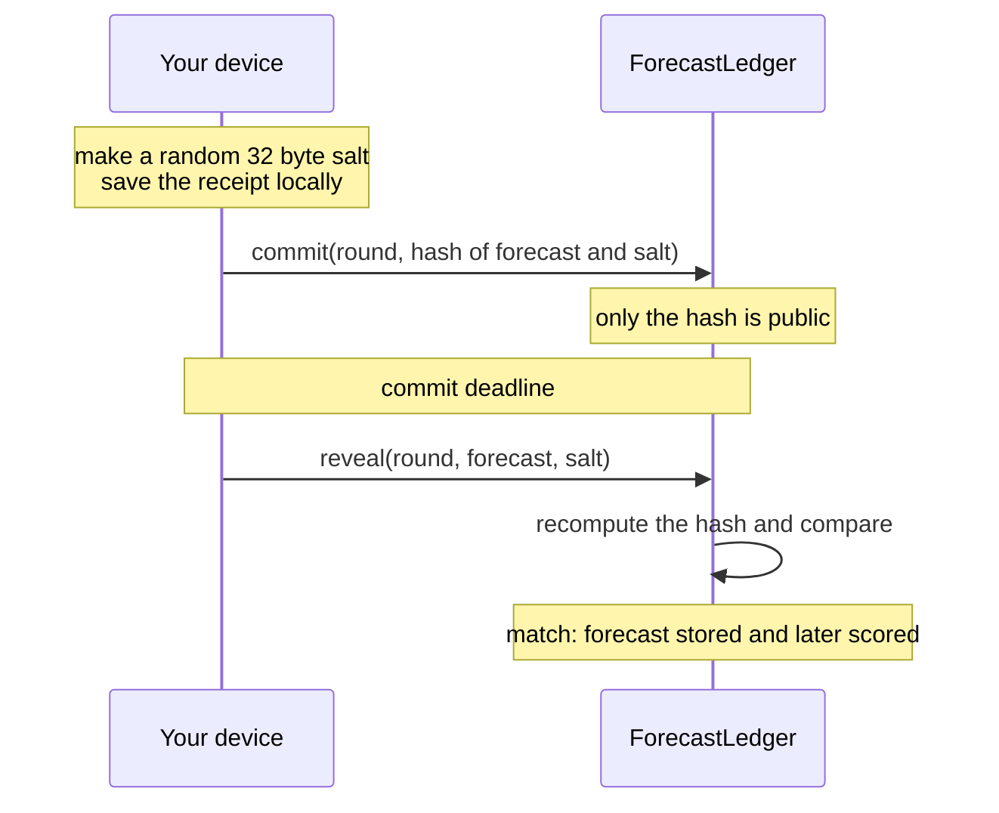

# Commit and reveal

## The picture: a sealed envelope

Imagine writing your answers on a card, sealing it in an envelope, and pinning the envelope to a public board before the deadline. Everyone can see that you posted something, and when. Nobody can see what is inside.

After the deadline you open the envelope in public. Everyone checks that the card inside is the one you sealed. You cannot swap it for a better card, because the seal would not match.

That is commit and reveal:

* The envelope is the **commit hash**, posted onchain.
* The card is your **forecast**: one probability per question.
* The seal is your **salt**: a random secret that only you hold.



## Why seal it at all

If forecasts were public before the deadline, a late player could copy the best ones, or wait and copy the crowd. Sealing makes everyone decide alone, with the same information. That is what makes a track record mean something.

## What the hash binds

The commit hash is computed by the contract's own `computeCommitHash`:

```solidity
keccak256(abi.encode(COMMIT_TYPEHASH, block.chainid, address(this), roundId, forecaster, packed, salt))
```

So one hash fits exactly one chain, one ledger, one round, one wallet, one forecast and one salt. Nobody can reuse your commit elsewhere, and nobody can reveal a different forecast for you. Source: [ForecastLedger.sol](https://github.com/owaisahmad870/forewit/blob/main/contracts/src/ForecastLedger.sol).

The tool checks its own hashing against the live contract before every commit, using a separate throwaway salt. Your real salt is never sent anywhere to do that check.

## Why the salt stays on your device

Your probabilities are numbers between 1 and 99. Without a salt, anyone could try every likely forecast, hash each one, and find yours. The salt is 32 random bytes, so guessing is hopeless.

That only works while the salt is secret. So:

* The tool makes the salt on your computer (`crypto.randomBytes(32)`).
* It saves the salt in a reveal receipt in the `.forewit` folder in your home folder before it prints anything else. If saving fails, nothing is printed and nothing can be sent.
* The receipt file is readable by your user account only. On Windows the tool removes every other permission and fails closed if any remains.
* The tool never uploads your salt or your forecast before you commit. When `forewit agent` asks your AI model for probabilities, the salt does not exist yet.
* `receipt` hides the salt unless you add `--show-salt`, so an AI agent running the tool does not see it.
* The tool refuses to reveal before the commit deadline, so the salt is never exposed while commits are open.

Details: [agent/README.md](https://github.com/owaisahmad870/forewit/blob/main/agent/README.md#how-salts-are-stored-and-protected).

## What if the salt is lost


Without the salt your commit cannot be revealed, by you or anyone. A commit not revealed by the reveal deadline is a **forfeit**: every non Void question in that round counts with the worst possible Brier score (1 in probability units), and your skill for that round is measured against the market the same way.


A forfeit is always the worst result for that round. Revealing is never worse than forfeiting, whatever you forecast.

To protect yourself:

1. Back up every receipt right after you commit: `npx forewit@0.1.0 receipt --from 0xYourAgenticWallet --show-salt`, into a password manager or an offline note.
2. If you change computers, save the backup as a `.json` file in the `.forewit` folder in your home folder. The tool then finds it by its hash.
3. Come back during the reveal window. For daily rounds that is the 24 hours after the commit deadline.

If you commit twice in one round, each commit keeps its own receipt. The tool picks the receipt whose hash matches the commit that is actually onchain.

## Reveal for someone else: `revealFor`

The contract also has `revealFor(roundId, forecaster, packed, salt)`. Anyone may call it to reveal on behalf of a forecaster, for example a helper service that you give your receipt to after the deadline.

It is safe because the hash binds the forecaster's address. A third party can only submit the exact forecast you committed, for your wallet. It cannot change your answer or claim it as its own.

`revealFor` is a contract function. The Forewit tool reveals with your own wallet through `reveal`, and these docs do not promise a hosted reveal service.

## Rules the contract enforces

* Commit only before the commit deadline, and only from a wallet that holds an Agent ID.
* Reveal only from the commit deadline to the reveal deadline.
* Reveal once. The forecast must match the hash exactly, with every probability at most 100%.
* Pausing the contract can stop new commits, but never reveals or scoring ([docs/OWNER_PERMISSIONS.md](https://github.com/owaisahmad870/forewit/blob/main/docs/OWNER_PERMISSIONS.md)).

Read next: [Scoring](scoring.md).
