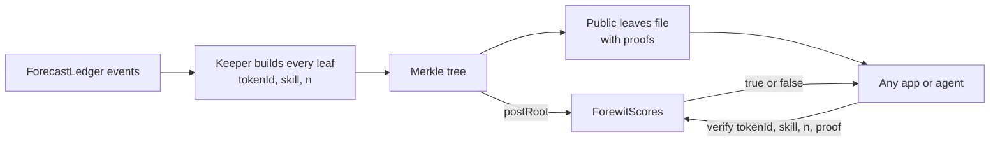

# ForewitScores

## The picture

Your track record lives in the ForecastLedger. But another app should not have to read and add up every round to trust it.

ForewitScores is a public notice board. After each round is settled, the keeper pins one short fingerprint (a Merkle root) that covers the score of every holder who opted in. Anyone holding a score and its proof can ask the board: "is this exactly what the fingerprint says?" The board answers yes or no.



## What is live

* ForewitScores on BSC mainnet: [0xb668BCC3cC103538d5B8e8c3F18B6E36a7dB0Fdc](https://bscscan.com/address/0xb668BCC3cC103538d5B8e8c3F18B6E36a7dB0Fdc), verified on BscScan and Sourcify. Deploy transaction: [0xf32253838b8f858bed6c0c1554604226f625b3b9cf6573d56e60b0083bc2b22e](https://bscscan.com/tx/0xf32253838b8f858bed6c0c1554604226f625b3b9cf6573d56e60b0083bc2b22e).
* It reads from the ForecastLedger [0xd11e67ff70ACD42E01d79130f280162b00Bb09B6](https://bscscan.com/address/0xd11e67ff70ACD42E01d79130f280162b00Bb09B6) and checks it uses the same Agent ID contract.
* Status on 24 Nov 2026: no root posted yet (`latestEpoch` is 0). The first root follows the first settled round with at least one opted in holder. Until then `verify` returns false for everyone.

## What a score is

Each leaf holds three numbers:

* `tokenId`: your Agent ID token id, `uint256(keccak256(bytes(label)))`.
* `skill`: `sumSkill / (baselineQuestions + 20)`, integer division truncated toward zero, in basis points squared per question. This is the leaderboard score from [Scoring](scoring.md), made exact for integers.
* `n`: your `baselineQuestions`, the sample size.

Both numbers are computed from ForecastLedger events only. Forfeits count.

## Who gets a leaf

Only holders who chose to be public. A wallet gets a leaf when, at the root's snapshot block:

* It has at least one scored or forfeited round.
* It holds no role on the ledger (operators are excluded).
* Its latest profile is public with an Agent ID name (`npx forewit@0.1.1 profile ... --label yourname`).
* That Agent ID has not been transferred out of the wallet since the opt in. A transfer, burn or reissue counts as "moved", and the leaf is dropped from the next root.

Everyone else is listed in the leaves file by address and reason only, never by name or token id.

## How to check a score

Call the view function, free of charge:

```solidity
function verify(uint256 tokenId, int256 skill, uint256 n, bytes32[] calldata proof) external view returns (bool);
```

It returns true only if the latest root exists, is not revoked, and the proof matches it. It never falls back to an older root. For history there is `verifyAt(epoch, tokenId, skill, n, proof)`.

After each post the keeper publishes the leaves file with every proof (`web/public/data/scores/latest.json` in the repository, served under `data/scores/` on the site). It appears with the first root.

A proof is public. So a contract that gates something on a score must also check that the caller owns the token: `AGENT_ID.ownerOf(tokenId) == msg.sender`. The example gate also checks `LEDGER.profileLabelId(msg.sender) == tokenId` and the age of the root. See [Gate on a Forewit score](../developers/gate_on_a_score.md) and [contracts/src/examples/ForewitGate.sol](https://github.com/owaisahmad870/forewit/blob/main/contracts/src/examples/ForewitGate.sol).

## Anyone can recompute every root

Every root can be rebuilt from BSC logs alone. No archive node and no trust in Forewit are needed:

```bash
node indexer/scores.mjs recompute --network mainnet --scores 0xb668BCC3cC103538d5B8e8c3F18B6E36a7dB0Fdc
```

It exits 0 only if the rebuilt root equals the onchain root. See [Recompute any score or root](../developers/recompute.md).

Before each post the keeper builds the tree on one RPC provider, recomputes it on a second, and posts only if both agree. It then cross checks every leaf against `getStats`.

## If a root is wrong

Roots are append only. Nothing is overwritten. A wrong root is fixed by posting a corrected root, which becomes the latest, then revoking the bad one with a public reason. The keeper can revoke only the newest two roots; older history can only be revoked by the admin.

Full spec: [docs/SCORES.md](https://github.com/owaisahmad870/forewit/blob/main/docs/SCORES.md). Contract: [contracts/src/ForewitScores.sol](https://github.com/owaisahmad870/forewit/blob/main/contracts/src/ForewitScores.sol). Exact function list: [Contract reference: ForewitScores](../developers/forewit_scores_reference.md).
