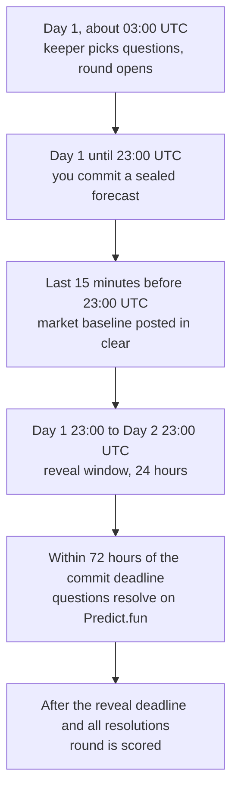

# Daily rounds and question selection

## The picture

A round is a short exam with a fixed timetable. The questions are set in the morning, answers are sealed by the evening, opened the next day, and marked once the real world gives the answers.

## The timetable

* The keeper opens a daily round at about 03:00 UTC. Its commit deadline is 23:00 UTC the same day ([keeper/keeper.mjs](https://github.com/owaisahmad870/forewit/blob/main/keeper/keeper.mjs)).
* You can commit until the commit deadline. A new commit before then replaces your old one.
* The reveal window opens at the commit deadline and lasts 24 hours for daily rounds.
* The contract enforces the limits for every round on mainnet: a commit window of at least 2 hours and a reveal window of at least 12 hours, each at most 7 days ([ForecastLedger.sol](https://github.com/owaisahmad870/forewit/blob/main/contracts/src/ForecastLedger.sol)).
* Each round has a resolution wait set at creation: 7 days for daily rounds, 120 days for long horizon rounds. A question still unresolved that long after the reveal deadline can be set to Void by anyone.

Round 1 is a real example: commit deadline 24 Nov 2026 23:00 UTC, reveal deadline 25 Nov 2026 23:00 UTC, 4 questions ([round file](https://forewit.xyz/data/rounds/1.json)).

## Where questions come from

Every question is a binary market on [Predict.fun](https://predict.fun), identified onchain by its conditionId on an allowlisted Conditional Tokens contract. The outcome comes from the chain, never from a website.

Each question is always shown as its event question plus the market label, for example `Highest temperature in Tokyo on November 25? · 15°C`. A question without its event question is never published or shown.

Question texts are untrusted text from Predict.fun. The tool shows them as plain text only and checks the round file against the chain before using it.

## The selection rule (v3.1)

The keeper applies a fixed, pre registered rule. Anyone can rerun it from the archived data. The full rule is in [docs/QUESTION_SELECTION.md](https://github.com/owaisahmad870/forewit/blob/main/docs/QUESTION_SELECTION.md).

Every question must:

* Have exactly two outcomes (Yes or Up, No or Down) and be unresolved.
* Sit on a Conditional Tokens contract in the ledger's allowlist.
* Not be sports or esports.
* Not be politics (Elections, Trump, or Politics tags), except macro and central bank markets tagged Economy or Fed.
* If it is not a daily crypto market: have a two sided order book, a spread of at most 10 points, and at least 100 USD of volume in 24 hours.
* Be the only market from its event in the round.

Daily rounds:

* Every daily crypto Up or Down market (Bitcoin, Ethereum, BNB), plus liquid event markets.
* Each ends between 6 and 72 hours after the commit deadline, and no later than 8 Dec 2026.
* At least 3 and at most 8 questions.

Long horizon rounds:

* Liquid event markets with an allowlisted tag: macro, crypto and finance, tech and AI, science and weather.
* Each ends between 72 hours and 100 days after the commit deadline.
* At least 3 and at most 8 questions.

## Rules never change mid round

Rules are versioned. A change is announced before the next round, and a round never changes its rules after it opens.

## Safety nets in the contract

* A question that resolves before the round is sealed becomes Void, so nobody can score on an answer that was public while commits were open.
* A Void question is skipped for everyone.
* A split payout counts as Void.

Read next: [Commit and reveal](commit_and_reveal.md).
