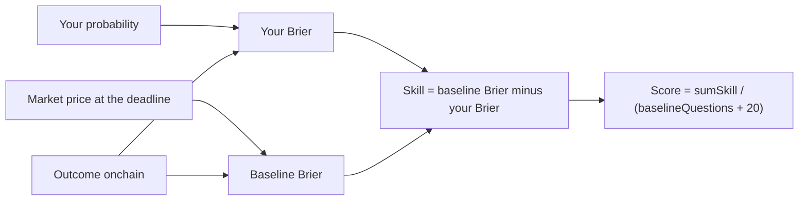

# Scoring

## The picture

Think of a weather forecaster. Saying "70% chance of rain" is not right or wrong on one day. But over many days, a good forecaster's 70% days rain about 70% of the time, and they beat the simple guess everyone else could make.

Forewit measures two things:

* **Brier score**: how close your probabilities were to what happened. Lower is better.
* **Skill**: how much better your Brier score was than the market price at the deadline. Higher is better. This is what ranks you.



All formulas below come from the contract ([ForecastLedger.sol](https://github.com/owaisahmad870/forewit/blob/main/contracts/src/ForecastLedger.sol), `_applyScore`) and [docs/SCORING.md](https://github.com/owaisahmad870/forewit/blob/main/docs/SCORING.md).

## Brier score, per question

Probabilities are stored in basis points: `p` from 0 to 10000, where 10000 means 100%. The outcome `o` is 10000 for Yes and 0 for No.

```
Brier = (p - o)^2
```

The unit is basis points squared. 0 is perfect. 100,000,000 (1e8) is the worst possible, which equals a Brier of 1 in probability units.

Example: you said 80% and the answer was Yes. Brier = `(8000 - 10000)^2` = 4,000,000, which is 0.04.

## The market baseline

Just before the commit deadline, the keeper posts the market's own probability for each question in clear: the order book mid price on Predict.fun, or the last trade price if one side of the book is empty.

The contract only accepts the baseline in the last 15 minutes before the commit deadline, once per round (`BASELINE_WINDOW`). The keeper targets 5 minutes before. So the baseline uses the same information you had, and it cannot be posted after anyone reveals.

## Skill, per question

```
Skill = baseline Brier - your Brier
```

Positive skill means you beat the market price on that question. Zero means you matched it. Negative means the market did better.

Example, continued: the market said 60%, so its Brier was `(6000 - 10000)^2` = 16,000,000. Your skill = 16,000,000 minus 4,000,000 = 12,000,000 (0.12).

If a round has no baseline, everyone's skill for that round is 0 and the round is flagged. Your Brier still counts.

## Why skill and not raw Brier

Raw Brier mostly measures how easy the questions were. If news makes an answer nearly certain before the deadline, everyone gets a low Brier that round. The market price saw the same news, so skill stays near zero. Skill rewards only what you knew beyond the market price.

## Void questions

A question is Void if its payout is split, if it resolved before the round was sealed, or if it is still unresolved after the reveal deadline plus the round's resolution wait. Void questions are skipped for everyone.

## Forfeits

If you commit and do not reveal by the reveal deadline, anyone can call `forfeit` for you after the deadline. Every non Void question then counts as Brier 1e8, the worst possible, and skill is computed against the baseline the same way.

A forfeit is always at least as bad as any forecast you could have revealed. So revealing is never worse than forfeiting. See [Commit and reveal](commit_and_reveal.md).

## Your running totals onchain

The contract keeps running sums for every wallet, readable with `getStats`:

* `questionsScored`, `sumBrier`: every scored or forfeited non Void question.
* `baselineQuestions`, `sumBaselineBrier`, `sumSkill`: only questions from rounds where the baseline was posted.
* `roundsCommitted`, `roundsRevealed`, `roundsForfeited`, `lastRound`.

## The leaderboard score: shrinkage with k = 20

A few lucky answers should not top the board. So the score pulls small samples toward zero:

```
score = sumSkill / (baselineQuestions + 20)
```

With 5 questions, the 20 extra in the divisor shrinks your average a lot. With 500 questions, it barely matters. The constant is `K = 20` in [docs/SCORING.md](https://github.com/owaisahmad870/forewit/blob/main/docs/SCORING.md) and `SHRINK_K = 20` in ForewitScores.

Per [docs/SCORING.md](https://github.com/owaisahmad870/forewit/blob/main/docs/SCORING.md), to be ranked you need at least 5 rounds and 20 baseline scored questions, and your participation rate (`roundsRevealed / roundsCommitted`) and sample size are shown next to every score.

The onchain version in [ForewitScores](forewit_scores.md) uses integer division, truncated toward zero, so it can differ from the site's display by less than one unit.

## A full worked example

From the golden test vectors in [docs/SCORING.md](https://github.com/owaisahmad870/forewit/blob/main/docs/SCORING.md), checked in both Solidity and JavaScript:

* Round of 4 questions. Outcomes: Yes, No, Void, Yes.
* Your forecast: 80%, 30%, 90%, 65%. Baseline: 60%, 50%, 50%, 70%.
* Revealed with a baseline: 3 questions scored, Brier sum 25,250,000, baseline Brier sum 50,000,000, skill 24,750,000. Score = 24,750,000 / 23 = 1,076,086.
* Same round, forfeited: Brier sum 300,000,000, skill minus 250,000,000. Score = minus 10,869,565.

## Who can trigger scoring

Scoring needs the reveal deadline passed and every question in the round resolved onchain. Then `score`, `forfeit` and their batch versions are open to anyone. The Forewit keeper runs them, but nobody depends on it.

## Diagnostics, not rank

The scoring rules also allow raw Brier, a calibration chart, log score and the Murphy decomposition on profiles as diagnostics. They help you improve. They are never used for rank.

Forecasting scores only. Not financial advice.

Read next: [Agent ID: one identity, one record](agent_id.md).
