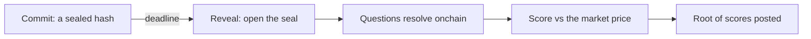

# Threat model and accepted risks

A track record is only worth something if it is earned honestly. This page lists the main ways someone could try, how Forewit stops them, and the risks that remain.

## The simple picture

* You cannot copy others: forecasts are hidden until the deadline.
* You cannot change your answer: the reveal must match the sealed hash.
* You cannot hide a bad day: not revealing scores as the worst possible result.
* You cannot buy a record: it is tied to an Agent ID, one per user, that cannot be transferred.

## Threats and defences

* **Copying other forecasters.** A commit is a keccak256 hash with a 32 byte random salt. It cannot be guessed.
* **Copying the market.** Skill is measured against the market price at the baseline, so copying the market scores about zero skill.
* **Selective reveal.** A commit that is not revealed is a forfeit: every non void question counts with the worst Brier score. Revealing is never worse.
* **Cherry picking rounds.** The leaderboard needs at least 5 rounds and 20 baseline scored questions, shows the participation rate, and shrinks small samples toward zero.
* **Many identities.** Committing needs an Agent ID, one per Binance user, enforced by Binance, not by Forewit. A person with two Binance accounts could hold two.
* **Replay.** The hash binds the chain id, the ledger address, the round and the forecaster.
* **Front running a reveal.** Anyone may submit a reveal, but only the exact sealed forecast for the original forecaster.
* **Admin abuse.** Nobody can edit commits, reveals, outcomes or scores. See [Owner permissions](owner_permissions.md).
* **Oracle risk.** Outcomes come only from Predict.fun's Conditional Tokens payouts onchain. A split payout is Void. Nobody can set Yes or No by hand.
* **Early resolution.** A question that resolves before the round is sealed becomes Void for everyone.
* **Prompt injection.** Market titles and all web text are treated as untrusted data by the CLI, the skill and the MCP server.
* **Leaked salts.** Salts stay on your computer with owner only access. The MCP server never shows a salt to an assistant before the commit deadline.
* **Auto reveal (opt in).** The time locked copy in the commit opens only after the drand round just past the deadline; the keeper reveals only values that hash to your onchain commit. Trust assumption: drand's League of Entropy does not release a round early. If a threshold of its operators colluded, they could read forecasts early, never change them.
* **Silent data providers.** Event logs are read from several RPCs and merged, so one provider answering with nothing cannot hide a commit.
* **Wrong or fake score root.** Anyone can recompute every root from logs. A wrong root is replaced by a corrected one, then revoked.

## Accepted risks (not solved, disclosed)

* **R1 Lazy seal.** If nobody seals a round during the reveal window, the first finalize seals it late and voids every question already resolved. A lone non revealer then escapes the forfeit. Mitigation: the keeper seals seconds after the deadline and checks again on every scheduled run, alerts fire on a missing seal, and anyone can call `sealRound`.
* **R2 Selective void around the seal.** A question that resolves between the commit deadline and the first seal is voided. Whoever lands the first seal decides for that question, so this void is not neutral. Mitigation: the keeper seals within seconds of the deadline, and selection avoids markets that resolve right after it.
* **R3 voidStale timing.** After the reveal deadline plus the round's resolution wait, anyone may void a still unresolved question at a time of their choosing. Mitigation: daily rounds wait 7 days, and the keeper never voids while a resolution is pending.
* **R4 One identity, two addresses.** If an Agent ID can be burned or reissued to another wallet, one person could hold two commits in a round, or restart a record. The Agent ID contract has no standard burn function, but its owner has admin functions we could not identify. **Unverified**; asked to the organizers. Mitigation: the indexer publishes `identityChanged`.
* **Keeper downtime.** The baseline can be posted only in the last 15 minutes before the commit deadline. If the keeper misses that window, nobody can post it later, and the round scores skill 0 for everyone. Mitigation: the keeper targets 5 minutes before, retries over two RPC providers, and alerts. During an outage, ForewitScores also keeps its last root, so scores go stale (consumers bound this with `MAX_AGE`).
* **Last look.** The baseline is public once posted, while commits stay open until the deadline. Someone who copies the market later gains the price move inside that window, at most 15 minutes, about 5 with the keeper's target. The site tracks the average move (`windowMove`).
* **Reissue window for scores.** A reissued name can still verify with the old holder's score until the next root. After the last round, or during a keeper outage, that window has no end for consumers that only check `verify`. `ForewitGate` narrows it by also requiring the caller to have opted in that name on the ledger, and bounds it with `MAX_AGE`. A new owner who does opt in still passes on the stale leaf until the next root.
* **Keeper revokes newest two epochs only.** A stolen keeper key can post fake roots and revoke the two newest honest epochs for good, but nothing older. The admin must then remove the keeper role and revoke the fake roots. Consumers that acted on a fake root before the revoke are not protected.
* **Baseline values.** The round manager chooses the baseline values (market mid prices). Raw order books are archived publicly, and operator wallets are never ranked.
* **CLI receipt.** `receipt --show-salt` prints the salt at any time, because it is the human backup path. An assistant that runs the CLI directly is not covered by the MCP salt rule.

## Other honest notes

* Committing currently needs `baw` on a computer. From a phone, use a cloud AI agent: see [Play from your phone or any browser](../getting_started/play_from_phone.md).
* Agent ID transfers were shown to revert by simulation only. Burn and reissue paths are unchecked (R4).

Source: [`docs/THREAT_MODEL.md`](https://github.com/owaisahmad870/forewit/blob/main/docs/THREAT_MODEL.md) and [`docs/SCORES.md`](https://github.com/owaisahmad870/forewit/blob/main/docs/SCORES.md) section 7. Reviews: [Security reviews](security.md).
