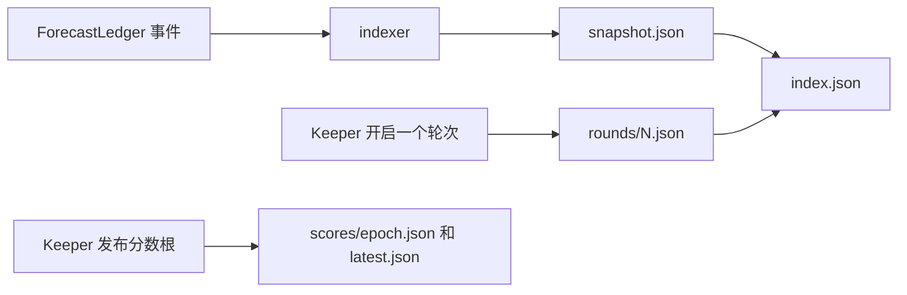

# 公开数据文件

先见 Forewit 的网站是静态的。它显示的每个数字都来自少数几个 JSON 文件，每次 keeper（维护程序）运行后都会根据 BSC 事件重建。你可以直接读取这些文件。

基础 URL：`https://forewit.xyz/data/`（备用 `https://forewit.pages.dev/data/`）。

## 完成后你将拥有

* 你会知道轮次、分数和证明分别该取哪个文件，以及每个字段的含义。

## 步骤

1. 获取 `index.json`，找到快照和轮次文件。
2. 获取 `snapshot.json`，得到链上状态和指标。
3. 获取 `rounds/<id>.json`，得到问题文本。
4. 在有根之后，获取 `scores/latest.json`，得到 Merkle 证明。

可能超过 2^53 的数字（轮次 id、区块号、总和）以十进制字符串表示。映射中的地址都是小写。

## `index.json`（清单）

* `sample`：实时数据为 false。
* `network`：BSC 主网为 56。
* `ledger`：ForecastLedger 地址。
* `publishedAt`：发布的 ISO 时间。
* `note`：一条简短的人工说明。
* `snapshot`：快照路径，`snapshot.json`。
* `rounds`：轮次文件路径，例如 `rounds/1.json`。

## `snapshot.json`

由 [`indexer/build.mjs`](https://github.com/owaisahmad870/forewit/blob/main/indexer/build.mjs) 只根据 ForecastLedger 事件构建，并由 [`indexer/publish.mjs`](https://github.com/owaisahmad870/forewit/blob/main/indexer/publish.mjs) 与轮次文件一起发布。

* `network`、`ledger`、`agentId`：链 id 和两个合约。
* `builtAt`、`headBlock`：构建时间，以及构建所至的区块。
* `metrics`：
  * `distinctCommitters`：提交过的不同钱包数。
  * `rounds`：轮次数量。
  * `perDay`：每个 UTC 日的提交和揭示数量。
  * `windowMove`：前 5 个轮次中，从基准快照到提交截止时间之间市场的平均变动，以百分点计（`rounds`、`avgPts`、`thresholdPts` 0.5、`active`）。它用于监控有上限的“最后一眼”风险。
* `rounds`：每个轮次一条记录：
  * `roundId`、`createdBlock`、`commitDeadline`、`revealDeadline`、`resolutionWait`（秒）。
  * `questions`：`conditionId`、`ctf`、`yesSlot`、`marketId`。
  * `committers`、`revealed`：钱包列表。
  * `forecasts`：按钱包列出的已揭示打包预测。
  * `scored`、`forfeited`：按钱包的汇总 `{questions, brier, skill}`。
  * `outcomes`：每个问题为 `Unresolved`、`Yes`、`No` 或 `Void`。
  * `baseline`：打包后的市场基准，若未发布则为 null。
  * `crowd`：Agent ID 群体预测 `{method, bps}`，或 null。
  * `commitTiming`：按钱包的 `{at, afterBaseline, gapSec}`。
  * `flags`：轮次标志，例如 `baseline_missing`。
  * `commitCount`、`revealRate`。
* `profiles`：设置过公开资料的钱包，`{isPublic, name}`。只会出现选择加入的名称。
* `operators`：keeper、admin 和 pauser 钱包。它们永远不参与排名。
* `identityChanged`：ledger 上线后 Agent ID 离开了其钱包的提交者。
* `firstCommits`：每个钱包的首次提交 `{tx, roundId, block}`，proof 页面用它统计不同的持有者数量。

## `rounds/<id>.json`

由 keeper 在开启轮次时写入。CLI 的 `--round-file` 会读取这个文件，并与链上数据交叉核对。

* `network`、`ledger`、`roundId`、`kind`（`daily`）、`rule`（选题规则，例如 `QUESTION_SELECTION v3.1`）。
* `commitDeadline`、`revealDeadline`、`resolutionWaitSeconds`。
* `marketPriceAt`（如有）：读取下方市场价格的时间。
* `windowMovePts`（如有）：本轮次中，从基准快照到截止时间之间的市场变动。
* `questions`，按顺序：
  * `index`、`marketId`、`conditionId`、`ctf`。
  * `eventQuestion` 和 `label`：始终一起显示为“事件问题 · 标签”。
  * `marketQuestion`、`endsAt`、`tags`。
  * `marketPrice`（如有）：截止时间之前最新公布的价格，0 到 1。

问题文本来自 Predict.fun，请视为不可信文本。

## `scores/<epoch>.json` 和 `scores/latest.json`

由 keeper 在每次发布 ForewitScores 根之后写入。**目前尚不存在**：截至 2026 年 11 月 24 日，尚未发布任何根。下面的结构来自 [`indexer/scores.mjs`](https://github.com/owaisahmad870/forewit/blob/main/indexer/scores.mjs) 中的 `leavesFile`。

* `chainId`、`ledger`、`scores`、`agentId`。
* `epoch`、`roundId`、`snapshotBlock`。
* `method`：`forewit scores v1: skill = sumSkill / (baselineQuestions + 20), truncated toward zero`。
* `root`、`leafCount`。
* `leaves`：`{tokenId, forecaster, skill, n, proof}`。只包含用名称公开选择加入的持有者。
* `excluded`：`{forecaster, reason}`，reason 为 `operator`、`not_public` 或 `moved`。从不包含 tokenId。

如果某个文件丢失，任何人都可以从日志重建它。参见 [重新计算任意分数或根](recompute.md)。

## 类型化访问

网站自己的加载器和类型定义在 [`web/src/lib/data.ts`](https://github.com/owaisahmad870/forewit/blob/main/web/src/lib/data.ts)。它把这些文件组合成轮次、问题和排行榜数据行，你可以复用其中的逻辑。
