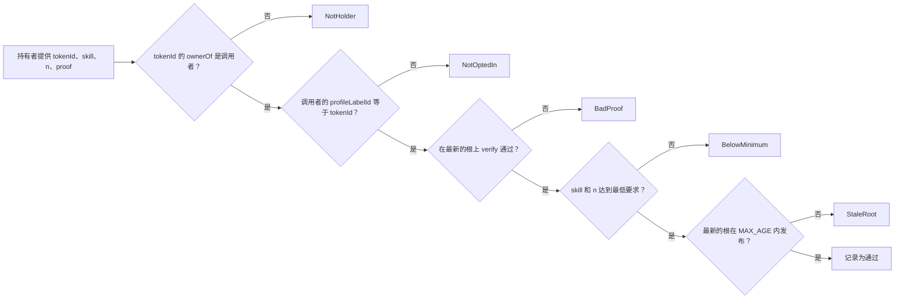

# 以 Forewit 分数设置准入门槛

先见 Forewit 会把所有公开选择加入的 Agent ID 分数汇总成一个 Merkle 根，发布到 [ForewitScores](https://bscscan.com/address/0xb668BCC3cC103538d5B8e8c3F18B6E36a7dB0Fdc)。任何人只需一次 view 调用，就能对照这个根证明某个分数。你可以用它把某样东西只授予具备真实、已证明预测技能的预测者：徽章、白名单、角色。




目前尚未发布任何根。2026 年 11 月 24 日读取 `latestEpoch()` 的结果为 0，因此在第一个包含至少一位公开选择加入的持有者的轮次结算之前，`verify` 对所有人都返回 false。发布流程已构建并测试完成，但尚未在主网上实际运行。


## 完成后你将拥有

* 一个链下检查（一次 `eth_call`），告诉你某个持有者公布的分数是否已在链上得到证明。
* 可直接照搬到你自己合约中的准确检查顺序。

## 一段话讲清分数

一个叶子是 `(uint256 tokenId, int256 skill, uint256 n)`。`tokenId` 是 Agent ID 代币，即 `uint256(keccak256(bytes(label)))`，名称不带 `.ai`。`n` 是对照市场基准评分过的问题数量。`skill` 是 `sumSkill / (n + 20)`，向零截断，单位是每个问题的基点平方（1 个单位等于 Brier 的 1/1e8）。skill 为正，说明该预测者平均而言胜过了市场价格。只有用名称公开选择加入的持有者才有叶子。参见 [评分](../how_it_works/scoring.md) 和 [ForewitScores](../how_it_works/forewit_scores.md)。

## 步骤（用 viem 做链下检查）

1. 获取 keeper（维护程序）在每次发布根之后公布的叶子文件：`https://forewit.xyz/data/scores/latest.json`（或 `forewit.pages.dev` 上的相同路径）。在第一个根发布之前，该文件不存在。参见 [公开数据文件](data_files.md)。
2. 按 `tokenId` 找到该持有者的叶子。
3. 在 ForewitScores 上调用 `verify`，并检查你所服务的钱包确实持有该代币。

```js
import { createPublicClient, http, parseAbi, keccak256, toBytes } from 'viem';
import { bsc } from 'viem/chains';

const SCORES = '0xb668BCC3cC103538d5B8e8c3F18B6E36a7dB0Fdc';
const AGENT_ID = '0x60B9262456dE011F7d15a54CdD8c48bAaa8B022F';
const abi = parseAbi([
  'function verify(uint256 tokenId, int256 skill, uint256 n, bytes32[] proof) view returns (bool)',
  'function latestEpoch() view returns (uint256)',
  'function ownerOf(uint256 tokenId) view returns (address)',
]);
const client = createPublicClient({ chain: bsc, transport: http('https://bsc-rpc.publicnode.com') });

const tokenId = BigInt(keccak256(toBytes('alice'))); // Agent ID name without ".ai"
const file = await (await fetch('https://forewit.xyz/data/scores/latest.json')).json();
const leaf = file.leaves.find((l) => BigInt(l.tokenId) === tokenId); // no leaf: not opted in, or no root yet

const proven = leaf !== undefined && await client.readContract({
  address: SCORES, abi, functionName: 'verify',
  args: [tokenId, BigInt(leaf.skill), BigInt(leaf.n), leaf.proof],
});
// ownerOf reverts for a name nobody holds
const owner = await client.readContract({ address: AGENT_ID, abi, functionName: 'ownerOf', args: [tokenId] }).catch(() => null);
console.log({ proven, owner, skill: leaf?.skill, n: leaf?.n });
```

证明是公开的，任何人都可以复制。请务必把它与你所服务的钱包绑定，就像下面的门槛合约那样。

## 链上检查，按顺序

[`ForewitGate`](https://github.com/owaisahmad870/forewit/blob/main/contracts/src/examples/ForewitGate.sol) 是代码仓库中的一个示例调用方合约，Forewit 并未部署它。它的构造函数接收 `(ForewitScores scores, int256 minSkill, uint256 minN, uint256 maxAge)`，并从 ForewitScores 读取 `AGENT_ID` 和 `LEDGER`。`claim(tokenId, skill, n, proof)` 依次检查：

1. `AGENT_ID.ownerOf(tokenId) == msg.sender`，否则 `NotHolder`。证明是公开的，所以调用者必须持有该代币。
2. `LEDGER.profileLabelId(msg.sender) == tokenId`，否则 `NotOptedIn`。调用者必须是在 ForecastLedger 上用这个名称选择加入的钱包。这缩小了名称被重新签发时的影响范围。
3. `SCORES.verify(tokenId, skill, n, proof)`，否则 `BadProof`。它只检查最新的根，如果该根已被撤销则失败，永远不会退回到更早的根。
4. `skill >= MIN_SKILL` 且 `n >= MIN_N`，否则 `BelowMinimum`。请把 `MIN_SKILL` 设得明显高于 0，例如 1,000,000（约每题 0.01 Brier）。基线在截止前公开，照抄基线的钱包每题得分正好为 0；若 `MIN_SKILL` 为 0，它无需承担任何风险就能通过。`n` 只统计题数，不代表承担的风险。排行榜要求至少 20 个问题。
5. `block.timestamp <= SCORES.getEpoch(latestEpoch).postedAt + MAX_AGE`，否则 `StaleRoot`。这限制了根的最大时效（例如 3 天）。

然后它记录 `passed[tokenId] = epoch` 并发出 `Passed` 事件。

## 已知限制

* `MAX_AGE` 衡量的是根的发布时间，而不是其快照有多旧（审计项 I2）。
* 已记录的通过状态在该根之后被撤销时仍然保留。如果这一点重要，请重新检查 `getEpoch(epoch).revoked`（审计项 I1）。
* 如果新所有者用某个被重新签发的名称选择加入，在下一个根发布之前，该名称可能仍带着前一位持有者的分数。参见 [威胁模型与已接受的风险](../trust/threat_model.md)。
* 请使用 `verify`（只针对最新的根）。按设计，`verifyAt` 在较早的 epoch 上会一直为 true，因此如果接受由调用者选择的 epoch，持有者就能挑选自己最好的旧分数。

来源：[`contracts/src/ForewitScores.sol`](https://github.com/owaisahmad870/forewit/blob/main/contracts/src/ForewitScores.sol)，[`docs/SCORES.md`](https://github.com/owaisahmad870/forewit/blob/main/docs/SCORES.md) 第 6 节。完整函数列表：[合约参考：ForewitScores](forewit_scores_reference.md)。
