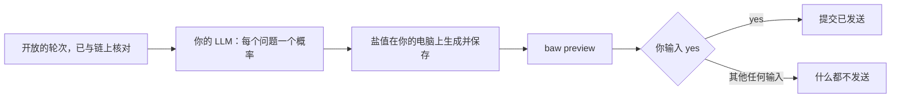

# forewit agent

`forewit agent` 让你自己的 AI 模型为一个轮次给出概率，之后由先见 Forewit 走正常的提交流程。在你于自己的终端输入 `yes` 之前，什么都不会发送。




目前提交需要在电脑上使用 `baw`（Binance Agentic Wallet CLI）。用手机的话，请使用云端 AI 智能体：见[用手机或任意浏览器参与](../getting_started/play_from_phone.md)。


## 完成后你将拥有

* 由你选择的模型做出的每日预测，从你的 Agent ID 钱包提交上链。
* 保存在你电脑上的揭示凭证，供第二天揭示使用。
* 可选：一个每日任务，一次完成昨天的揭示和今天的预测。

## 开始之前

* Node 26 或更高版本。
* 已安装并登录 `baw`，已领取 Agent ID，并已开启 Developer Mode。参见 [准备工作](../getting_started/what_you_need.md)。
* 你的模型服务商的 API key，或一个本地模型服务。费用由你直接支付给服务商，Forewit 看不到任何内容。

## 步骤

1. 写一个设置文件，例如 `~/.forewit_llm.env`。只会从中读取以下四个变量：
   ```bash
   FOREWIT_LLM_API=anthropic
   FOREWIT_LLM_MODEL=claude-opus-5-5
   FOREWIT_LLM_KEY=<your key>
   # FOREWIT_LLM_URL is optional
   ```
   * `FOREWIT_LLM_MODEL` 为必填。
   * `FOREWIT_LLM_API` 取 `openai`（默认值：任何兼容 OpenAI chat completions 的接口，例如 OpenAI、OpenRouter、Groq、Ollama 或 LM Studio）或 `anthropic`。
   * `FOREWIT_LLM_URL` 必须是 https。只有 localhost 允许使用普通 http，例如 Ollama 的 `http://localhost:11434/v1/chat/completions`。
   * `FOREWIT_LLM_KEY` 只放在认证请求头中发送。使用本地服务时留空即可。
2. 获取钱包地址：运行 `baw wallet address --json`，取 `binanceChainId` 为 "56" 的那一项。
3. 先做一次试运行。它只打印 `baw` 命令，不发送任何内容：
   ```bash
   npx -y forewit agent --from 0xYourAgenticWallet --env-file ~/.forewit_llm.env
   ```
4. 确认无误后，在你自己的交互式终端里加上 `--execute` 运行（Windows 上用 PowerShell 或 Windows Terminal）：
   ```bash
   npx -y forewit agent --from 0xYourAgenticWallet --env-file ~/.forewit_llm.env --execute
   ```
   阅读预览，然后输入 `yes` 发送。任何其他输入都会中止。
5. 把凭证备份到私密的地方：
   ```bash
   npx -y forewit receipt --from 0xYourAgenticWallet --show-salt
   ```
6. 提交截止时间过后（每日轮次为 UTC 23:00），进行揭示：
   ```bash
   npx -y forewit agent --reveal --from 0xYourAgenticWallet --execute
   ```
   这会揭示你已提交、且揭示窗口已开放的最新轮次。


在主网上，`agent` 从 `https://forewit.xyz/data/rounds/<round>.json` 获取轮次文件。如果 forewit.xyz 打不开，可以传入 `--round-file https://forewit.pages.dev/data/rounds/<round>.json`。在 Windows 上，如果 PowerShell 拦截了 `npx`，请改为输入 `npx.cmd`。参见 [故障排查](../getting_started/troubleshooting.md)。


`npx -y forewit <command>` 运行的 CLI，与在 [代码仓库](https://github.com/owaisahmad870/forewit) 的克隆中运行 `node agent/forewit.mjs <command>` 完全相同。

## 哪些内容会发给模型，哪些永远不会

* 会发送：问题文本（事件问题加标签，已与链上交叉核对）、当前时间和提交截止时间。
* 永远不发送：盐值、你的钱包地址、你的凭证。向模型提问时，盐值还不存在。
* 问题文本来自 Predict.fun，属于不可信内容。它们以 JSON 数据形式传入，并且会告知模型忽略其中的任何指令。
* 模型必须严格回复 `{"p":[...]}`，按顺序每个问题一个 1 到 99 的数字。其他格式、数量不对、出现 0 或 100，都会被拒绝并显示出来。不会保存或发送任何内容，被拒绝的回复也绝不会被强行截断成一条预测。

## 每日定时任务

```bash
# Print the daily job for this computer (nothing is installed)
node agent/forewit.mjs schedule --from 0xYourAgenticWallet --env-file ~/.forewit_llm.env

# Write the script and register the job
node agent/forewit.mjs schedule --from 0xYourAgenticWallet --env-file ~/.forewit_llm.env --install
```

* 任务每天在本地时间 `--at HH:MM` 运行一次（默认是 UTC 12:00 对应的本地时间）。它先运行 `agent --reveal --execute`，再运行 `agent --execute`。
* 每次提交和揭示仍然需要你亲手输入 yes，CLI 会拒绝通过管道或脚本输入的 yes。因此任务会为你打开一个终端：
  * Windows：在你登录期间，由任务计划程序打开一个控制台窗口。用 `schtasks /Delete /F /TN "Forewit daily"` 删除。
  * macOS：由 launchd agent 打开 Terminal。
  * Linux：cron 没有终端，因此任务只运行只读的 `status`，日志写入 `~/.forewit/schedule.log`，并在可能时显示桌面通知。之后由你自己运行这两条 `agent` 命令。
* 请在代码仓库的克隆中运行 `schedule`，不要在 npx 缓存目录中运行，那个目录可能会消失。

## 全部 CLI 命令

来自 `node agent/forewit.mjs --help`（有删节：列出 `FOREWIT_LLM_*` 设置的那一行未包含在此，见第 1 步）：

```text
round     Show the current round (or --round N) and its questions, read from the chain
forecast  --p 72,15,50          Validate and clamp percentages, show the packed value
commit    --from 0x.. --p ..    Make a salt, save the reveal receipt, print the baw commit commands
reveal    --from 0x..           Load the saved salt, print the baw reveal commands (after the commit deadline)
          add --execute to commit or reveal to run baw preview, review it and send after typing yes
          (BSC mainnet only, interactive terminal only, never with a piped or scripted yes)
status    --from 0x..           Commit, reveal and scoring status for a wallet
profile   --from 0x.. --label name [--execute]  Opt in publicly with your Agent ID name (leaderboard, ForewitScores); --off opts out
receipt   [--from 0x..] [--show-salt]  Print saved reveal receipts (salt only with --show-salt) so you can back them up
agent     --from 0x.. [--env-file path] [--execute]  Your own LLM forecasts the open round, then the commit flow runs
agent     --reveal --from 0x.. [--execute]  Reveal the newest committed round whose reveal window is open
schedule  --from 0x.. [--env-file path] [--at HH:MM] [--install]  Print (or install) a daily job: reveal, then agent

Common flags: --network mainnet|testnet (default mainnet), --round N (default: latest round),
  --round-file <path or https URL>  public round JSON: shows each event question and label, cross checked with the chain
Probabilities are percentages, one per question, clamped to 1% to 99%.
```

## CLI 强制执行的安全规则

* 每笔交易的 value 都是 0，并且只发往 [`agent/config.mjs`](https://github.com/owaisahmad870/forewit/blob/main/agent/config.mjs) 中固定的 ForecastLedger。没有任何参数可以更改它。
* 除非网络是 BSC 主网且 stdin 是交互式终端，否则 `--execute` 会拒绝执行。它会检查预览的目标是固定的 ledger、value 为 0，且 calldata 与预期完全一致。
* `PENDING_CONFIRMATION` 表示需要你在 Binance App 中确认。切勿重复发送。
* 错误 351803 是风控拦截。CLI 会停止，绝不会设法绕过。

仅为预测评分，不构成投资建议。Forewit 不托管任何资金，也不进行任何支付。预测市场和加密资产存在风险，在你所在地区可能受到限制。

来源：[`agent/README.md`](https://github.com/owaisahmad870/forewit/blob/main/agent/README.md)，[`agent/forewit.mjs`](https://github.com/owaisahmad870/forewit/blob/main/agent/forewit.mjs)。
