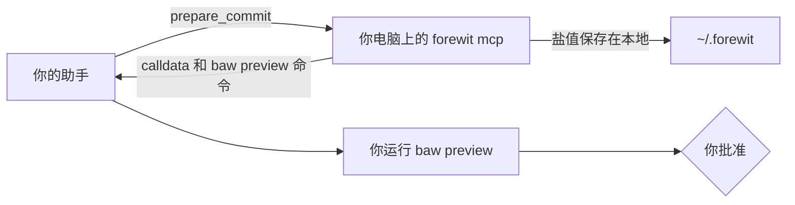

# MCP 服务器

先见 Forewit 的 MCP 服务器让 AI 助手为你准备 Forewit 交易。它运行在你自己的电脑上，从不签名、从不发送，也从不运行 `baw`。批准与否始终由你决定。



## 步骤

1. 安装 Node 22 或更高版本（这是该包的最低要求）。
2. 把服务器添加到你的客户端。各处使用的命令都相同：`npx -y forewit mcp`。
3. 重启客户端，确认出现七个工具：`prepare_commit`、`prepare_reveal`、`prepare_profile`、`my_receipts`、`wallet_status`、`commit_forecast`、`reveal_forecast`。

### Claude Desktop

编辑 `claude_desktop_config.json`（Settings，Developer，Edit Config）：

```json
{
  "mcpServers": {
    "forewit": {
      "command": "npx",
      "args": ["-y", "forewit", "mcp"]
    }
  }
}
```

### Claude Code

运行一次：

```bash
claude mcp add forewit -- npx -y forewit mcp
```

或者把上面同样的 JSON 写入项目根目录的 `.mcp.json`。

### Cursor

把同样的 JSON 写入 `~/.cursor/mcp.json`（或项目中的 `.cursor/mcp.json`）。


在 Windows 上，如果客户端无法启动 `npx`，请使用 `"command": "cmd"` 并配合 `"args": ["/c", "npx", "-y", "forewit", "mcp"]`。


## 本地工具（stdio）

所有工具默认使用 BSC 主网。`network` 可取 `mainnet` 或 `testnet`。

* `prepare_commit {from, probabilities_percent, round_id?, network?, auto_reveal?}`
  * `probabilities_percent`：每个问题一个百分比，共 1 到 16 个数字，限制在 1 到 99 之间。
  * 从 ledger 读取轮次。超过提交截止时间或问题数量不对时会拒绝。
  * 生成一个 32 字节的随机盐值，把凭证保存到 `~/.forewit/`（仅所有者可访问），并返回提交哈希、calldata、`{to, value: "0", data}` 以及准确的 `baw contract-call preview` 命令。
  * 不返回盐值（`salt_returned: false`）。
  * `auto_reveal`：默认 false（选择加入；请先询问用户，推荐开启）。设为 `true` 时，预测和盐值的一份副本会被时间锁定到提交截止后不久（drand quicknet），随 calldata 一起上链，截止后由 Forewit 的 keeper 揭示，用户无需第二步。此时输出为 `auto_reveal: true`。见 [提交与揭示](../how_it_works/commit_and_reveal.md)。
* `prepare_reveal {from, round_id?, network?}`
  * 提交截止时间（以链上时间为准）之前会被拒绝。
  * 截止之后，它会找到与你链上提交匹配的凭证，并返回揭示 calldata。和任何揭示一样，这段 calldata 包含盐值，而此时盐值本来就即将在链上公开。
* `prepare_profile {from, is_public, label?, network?}`
  * 生成 `setPublicProfile(bool,string)` 的 calldata。`label` 是不带 `.ai` 的 Agent ID 名称，只能包含小写字母、数字、下划线或连字符。
  * 选择退出时总会清除名称。
* `my_receipts {from?, round_id?, network?, include_salt?, cursor?, limit?}`
  * 返回凭证元数据和文件路径，最新的在前。
  * `include_salt: true` 会附带盐值，用于你主动要求的私密备份，并且只有当列出的每个轮次都已过提交截止时间才可用。在此之前调用会被拒绝。
  * 不是有效凭证的文件会被跳过，并列在 `warnings` 中。

* `wallet_status {}`：读取本机上你自己的币安 Agentic Wallet（是否登录、Agent ID、开发者模式、BSC 地址），不做任何更改。未登录时会说明如何用钱包 CLI 本身登录：Forewit 从不接触配对码。
* `commit_forecast {probabilities_percent, round_id?, auto_reveal?}`：从你已登录的钱包提交你自己的预测。它先保存回执，运行钱包预览，然后向**你**显示一个确认表单（MCP elicitation）。只有你在表单中输入 yes 才会发送；助手无法代填。不支持表单的客户端只会被拒绝，绝不会发送。
* `reveal_forecast {round_id?}`：揭示的相同流程。开启自动揭示后通常不需要，除非截止一小时后状态仍显示未揭示。

## 盐值规则

任何人只要同时看到盐值和你的预测，就能揭示或复制你的预测。因此在提交截止时间之前，盐值永远不会进入助手的上下文：

* `prepare_commit` 从不返回盐值。开启 `auto_reveal` 时，calldata 中只有时间锁定的副本，截止前任何人都无法读取。
* 在链上时间越过截止时间之前，`prepare_reveal` 以及带 `include_salt` 的 `my_receipts` 都会被拒绝。
* 截止之后，助手只会在揭示 calldata 中，或在你要求 `my_receipts` 做备份时看到盐值。


这条规则只覆盖 MCP 工具的输出。CLI 命令 `receipt --show-salt` 任何时候都会打印盐值，因为那是给人用的备份途径。直接运行 CLI 的助手不受这条规则保护。


## 保证

* 没有任何工具会签名、发送或运行 `baw`。有一项测试用一个会留下标记文件的假 `baw` 运行服务器，并检查它从未被调用。
* stdout 只传输 JSON RPC，日志写到 stderr。
* 网络访问只限于固定的 RPC。主目录或轮次文件 URL 永远不会作为工具输入。
* 在测试网上 `baw_can_sign_this_network` 为 false：`baw` 只在 BSC 主网上签名。

## 远程只读服务器

第二个服务器 `forewit mcp remote` **已部署在 https://forewit.xyz/mcp**（无需登录，只读）。可将其添加为连接器：在 Claude 中打开 设置、连接器、添加自定义连接器，粘贴该网址。它不能提交或签名：发送始终需要你自己的钱包（在电脑上运行 `npx forewit@latest start`）。

它通过 Streamable HTTP 提供的工具：

* `get_current_round`、`get_round`、`get_question`、`get_baseline`、`get_crowd`、`get_leaderboard` 和 `explain_scoring`。
* `get_markets`：统计每一类当前的 Predict.fun 市场数量，并说明每类是否进入先见轮次。它不列出标题或价格，因为 Predict.fun 的条款不允许转发其数据；请在你自己的智能体中使用你自己的免费密钥（https://developers.predict.fun）搜索市场。
* `get_my_status`：你的轮次、你在任意市场上的开放预测，以及一张用简单语言写的 `results` 成绩卡（"You beat the market by X points"，即你比市场准 X 分，或 "The market was closer by X points"，即市场比你准 X 分，并给出双方的失误分，即 Brier 乘以 100），与 [forewit.xyz/#/me](https://forewit.xyz/#/me) 上的成绩卡相同。
* `get_upcoming`：当前可提交的轮次，以及下一个每日轮次的开放时间（约 UTC 03:10 开放，UTC 23:00 截止提交）。

市场文本只会放在 `untrusted_market_text` 中返回，公开资料名称只会放在 `untrusted_profile_name` 中返回。

## 版本

* npm 包 `forewit` 0.1.2，由 GitHub Actions 发布并带有 npm provenance。默认使用主网。
* MCP 协议 `2025-11-25`。等官方 MCP SDK 支持 `2026-07-28` 后再跟进。
* 只提供工具：没有 resources、prompts、sampling、roots 或 elicitation。
* MCP Registry 条目（`io.github.owaisahmad870/forewit`）已在 [`mcp/server.json`](https://github.com/owaisahmad870/forewit/blob/main/mcp/server.json) 中准备好，尚未确认已上架。

来源：[`mcp/src/local.mjs`](https://github.com/owaisahmad870/forewit/blob/main/mcp/src/local.mjs)，[`mcp/src/remote.mjs`](https://github.com/owaisahmad870/forewit/blob/main/mcp/src/remote.mjs)，[`mcp/README.md`](https://github.com/owaisahmad870/forewit/blob/main/mcp/README.md)。
