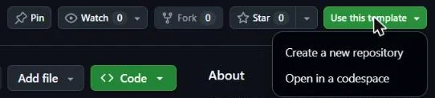
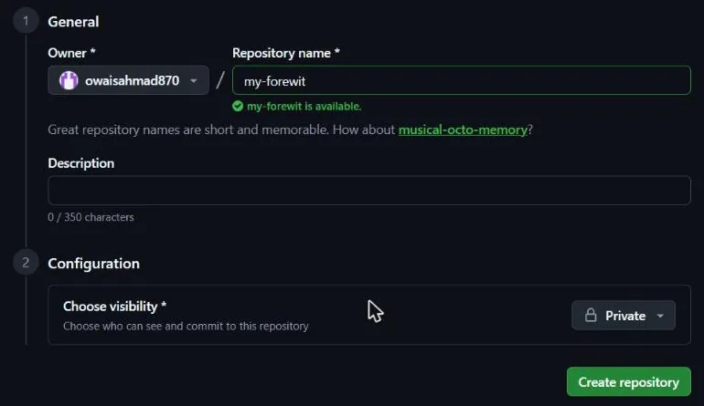
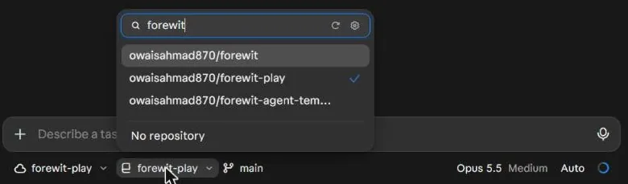
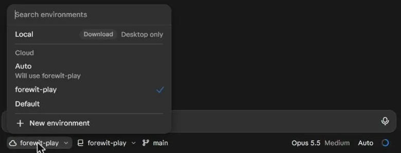
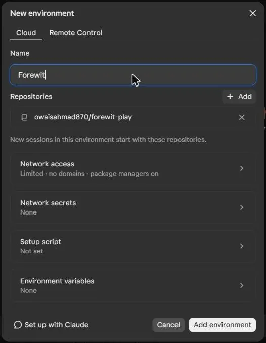
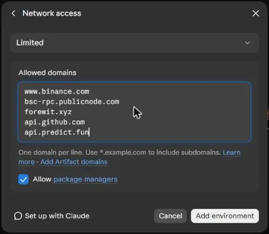
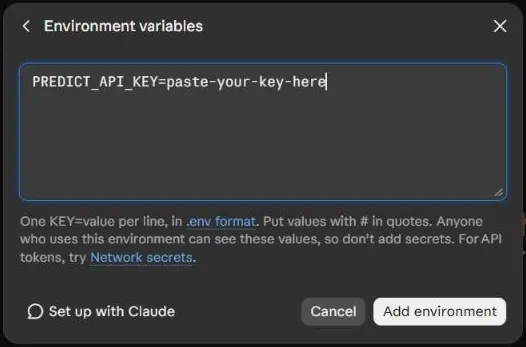
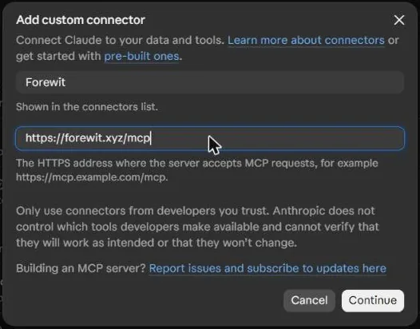

# 用手机或任意浏览器参与

浏览器里的云端 AI 智能体（网页版 Claude Code 或 Codex cloud）会读取轮次、准备你的预测、展示钱包预览，并且只有在你输入 yes 之后才会发送。不需要电脑。

仅为预测评分，不构成投资建议。


为什么不用普通聊天窗口？Agentic Wallet 只能通过它的命令行工具签名，而这需要命令行环境。聊天窗口（claude.ai、ChatGPT）没有；云端编程智能体有，并且运行在你自己的沙盒里。


## 一次设置（约五分钟）
以下均为真实截图。

1. 打开[先见智能体模板](https://github.com/owaisahmad870/forewit-agent-template)，点击 **Use this template**，再点击 **Create a new repository**。

   
2. 任意命名，选择 **Private**，点击 **Create repository**。回执保存在这里，所以务必保持私有。

   
3. 打开 **claude.ai/code**（或 Claude App 里的 Code 标签）。按提示连接 GitHub，然后选择你的新仓库。

   
4. 打开旁边的云端环境菜单，选择 **New environment**，命名为 Forewit。

   

   
5. 打开 **Network access**，保持 **Limited**，每行粘贴一个以下网站，并保留 **package managers** 开启：

   ```
   www.binance.com
   bsc-rpc.publicnode.com
   forewit.xyz
   api.github.com
   api.predict.fun
   ```

   
6. 预测任意市场：打开 **Environment variables**，把你在 developers.predict.fun 免费创建的密钥写成 `PREDICT_API_KEY=你的密钥`。这个环境只有你使用；切勿把密钥发到聊天里。然后点击 **Add environment**。

   
7. 可选：添加先见连接器，让 Claude 在任何对话中回答先见问题。在 claude.ai 打开 **Plugins**，点击 **Add**，再点击 **Add custom connector**，命名为 Forewit 并粘贴 `https://forewit.xyz/mcp`。它只读取，从不发送任何内容。

   

之后每次会话开始时会自动完成设置。检查：智能体的网络检查返回 2xx 或 3xx，而不是 403。

## 开始预测
1. 用你的仓库和 Forewit 环境开始新会话，发送以下任意一条：
   * `Forecast a market: bitcoin 15 minute`
   * `Forecast this market: <paste the question from predict.fun>`
   * `I say 70% Yes on: <paste the question from predict.fun>`
   * `Forecast today's Forewit round`
   * `How did I do?`
   * `What can I forecast right now?`
   * `Explain how Forewit scores me`
   * `Show the Forewit leaderboard`

   若要预测你自己挑选的市场，把它在 predict.fun 上的问题（或其中几个词）复制进消息里；如果已经想好概率，也一并写上。智能体会找到该市场，显示截止时间和当前价格，然后展示预览。
2. 智能体会给出一个登录链接和一个配对码。在同一部手机上点击链接，在币安 App 里核对配对码并批准。智能体显示 CONNECTED 以及你的 BSC 地址。
3. 给出你的概率。智能体把回执保存到你的私有仓库，并展示钱包预览（先见合约，金额为 0）。
4. 输入 yes。你会得到一个交易哈希，或者提示你在币安 App 里批准。
5. 这样就完成了：市场结算后自动揭示并计分。随时发送 `How did I do?` 查看结果。


回执里包含 salt。请保持你的模板副本为私有，绝不要把 salt 粘贴到任何地方。丢失 salt 意味着该轮按弃权计算。


## 谁持有什么
* 你的钱包密钥：币安（Agentic Wallet）。登录需你在币安 App 里批准。
* 钱包会话：只在你的云端沙盒里，每次会话结束时退出登录。
* 你的 salt 和回执：你的私有仓库。
* 先见：什么都不持有。它从不接触登录链接和配对码，从不托管登录页面，也从不保存钱包会话。

## 注意安全
* 你在这里使用的 Agentic Wallet 只保留少量用于 gas 的 BNB。
* 模板固定了 forewit 的版本，新版本不会在未经审阅的情况下与已登录的钱包一起运行。
