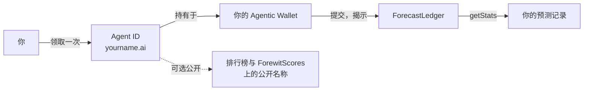

# Agent ID：一个身份，一份记录

## 打个比方

一份预测记录只有在属于某一个人、并且始终跟着这个人时才有价值。如果驾驶记录可以卖掉，或者换个驾照就能清零，那它什么也说明不了。

Agent ID 正好给了先见 Forewit 这个属性。它是你在 BNB Smart Chain 上的 `.ai` 名称：每个用户一个，而且无法转移到其他钱包。Forewit 只允许 Agent ID 持有者提交预测，所以每一份记录背后都是一个真实身份。



## 合约检查什么

* **提交时**：发送交易的钱包必须持有至少一个 Agent ID。账本会调用 `AGENT_ID.balanceOf(msg.sender)`，余额为零时以 `NoAgentID` 回滚。
* **揭示时**：不检查 Agent ID，只要求提交哈希匹配。因此即使你的 Agent ID 在提交与揭示之间发生了变化，你也不会被迫承受不公平的弃权。
* **公开资料时**（`setPublicProfile`）：账本根据你的名称算出 token id，并检查 `ownerOf(tokenId)` 是否为你的钱包，否则以 `LabelNotOwned` 回滚。

源码：[ForecastLedger.sol](https://github.com/owaisahmad870/forewit/blob/main/contracts/src/ForecastLedger.sol)。Agent ID 地址作为 immutable 值写死在账本中，无法更改。

## Agent ID 合约

* BSC 主网地址：[0x60B9262456dE011F7d15a54CdD8c48bAaa8B022F](https://bscscan.com/address/0x60B9262456dE011F7d15a54CdD8c48bAaa8B022F)，从线上账本的 `AGENT_ID()` 读回。
* 一个带元数据的 ERC721 代币，名称为 "SPACE ID Agent ID"，符号为 "AI"，不可枚举。
* 名称对应的 token id 为 `uint256(keccak256(bytes(label)))`，其中 label 是去掉 `.ai` 的名称。已在 4 个持有者中全部验证通过（4 of 4）。
* 每个用户只能领取一次，这是发行方的规则。

这些事实及其证据记录在 [notes/knowledge.md](https://github.com/owaisahmad870/forewit/blob/main/notes/knowledge.md)。

## 为什么这让记录难以伪造或买卖

* **每人一个。** 你无法开一百个钱包、只留下运气最好的那个，因为每个钱包都需要自己的 Agent ID。
* **不可转移。** 持有者模拟调用 `transferFrom`、`safeTransferFrom` 和 `approve` 都会回滚。好的记录无法连同代币一起卖掉。
* **弃权照样计分。** 你无法靠不揭示来隐藏糟糕的轮次。
* **看技能，不看运气。** 向零收缩让短暂的好运无法伪装成预测技能。参见 [评分](scoring.md)。
* **运营方除外。** 在账本上持有角色的钱包不会出现在排行榜和 ForewitScores 中。

## 坦诚说明局限

* 不可转移性来自模拟证据：转账和授权调用在模拟时会回滚。这不是发行方的正式保证。
* Agent ID 能否被销毁或重新发放给其他钱包，目前尚未验证，已作为开放问题提交给主办方。ForewitScores 会把已公开代币之后的任何转移（包括销毁或重新发放）视为“已移动”，并在下一个根中删除旧分数。参见 [ForewitScores](forewit_scores.md)。
* 持有你 Agent ID 的 Agentic Wallet 是一个独立钱包，有自己的地址。用其他钱包预测会以 `NoAgentID` 失败。

## 除非你主动公开，你的名称是私密的

从第一次提交起，你的记录就与钱包地址绑定。除非你自己选择公开，否则你的 Agent ID 名称永远不会显示：

```bash
npx forewit@0.1.4 profile --from 0xYourAgenticWallet --label yourname --execute
```

取消公开（`--off`）会移除公开名称，并让你从下一个 ForewitScores 根中移出。网站和 MCP 服务器从不为未公开的持有者提供按名称搜索。

继续阅读：[ForewitScores](forewit_scores.md)。
