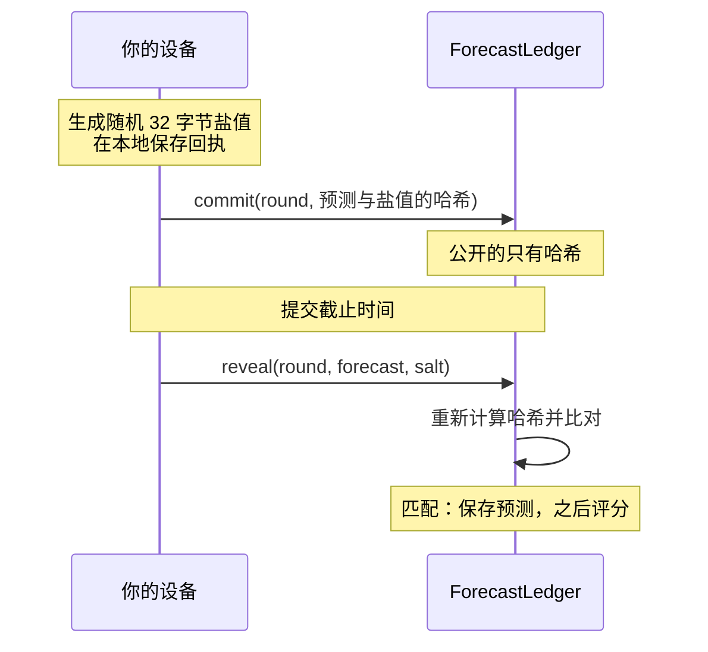

# 提交与揭示

## 打个比方：密封的信封

想象你把答案写在一张卡片上，封进信封，在截止时间前把信封钉到公共公告板上。所有人都能看到你交了东西、什么时候交的，但没人能看到里面写了什么。

截止时间过后，你当众拆开信封。所有人都会核对里面的卡片是否就是你封进去的那张。你没法换成一张更好的卡片，因为封印对不上。

这就是先见 Forewit 的提交与揭示：

* 信封就是链上公开的 **提交哈希**。
* 卡片就是你的 **预测**：每个问题一个概率。
* 封印就是你的 **盐值**：一个只有你持有的随机秘密。



## 为什么要密封

如果预测在截止时间前公开，后来者就可以抄袭最好的预测，或者等着跟随大众。密封让每个人在相同信息下独立做出判断，这正是预测记录有意义的前提。

## 哈希绑定了什么

提交哈希由合约自己的 `computeCommitHash` 计算：

```solidity
keccak256(abi.encode(COMMIT_TYPEHASH, block.chainid, address(this), roundId, forecaster, packed, salt))
```

所以一个哈希只对应一条链、一个账本、一个轮次、一个钱包、一份预测和一个盐值。没人能把你的提交挪到别处使用，也没人能替你揭示另一份预测。源码：[ForecastLedger.sol](https://github.com/owaisahmad870/forewit/blob/main/contracts/src/ForecastLedger.sol)。

每次提交前，工具都会用一个单独的一次性盐值，把自己的哈希算法与线上合约进行比对。做这项检查时，你真正的盐值不会被发送到任何地方。

## 为什么盐值只留在你的设备上

你的概率是 1 到 99 之间的数字。如果没有盐值，任何人都可以把所有可能的预测逐一哈希，从而找出你的答案。盐值是 32 个随机字节，猜中是不可能的。

但前提是盐值保密。所以：

* 工具在你的电脑上生成盐值（`crypto.randomBytes(32)`）。
* 在输出任何其他内容之前，工具会先把盐值存进你主目录下 `.forewit` 文件夹里的揭示回执。如果保存失败，就什么都不输出，也什么都发不出去。
* 回执文件只有你的用户账户可以读取。在 Windows 上，工具会移除其他所有权限，只要还有残留权限就会安全失败（fail closed）。
* 在你提交之前，工具从不上传你的盐值或预测。当 `forewit agent` 向你的 AI 模型询问概率时，盐值还根本不存在。
* `receipt` 默认隐藏盐值，除非你加上 `--show-salt`，因此运行该工具的 AI 智能体看不到它。
* 工具拒绝在提交截止时间之前揭示，所以在提交开放期间盐值绝不会暴露。

详情：[agent/README.md](https://github.com/owaisahmad870/forewit/blob/main/agent/README.md#how-salts-are-stored-and-protected)。

## 盐值丢失怎么办


没有盐值，你的提交就无法被揭示，你自己和任何人都不行。在揭示截止时间前未揭示的提交将被判为 **弃权**：该轮每个非 Void 问题都按最差的 Brier 分数计算（以概率为单位为 1），你在该轮相对市场的预测技能也按同样方式计算。


弃权永远是该轮最差的结果。无论你预测了什么，揭示都不会比弃权更差。

保护自己的方法：

1. 每次提交后立即备份回执：`npx forewit@0.1.0 receipt --from 0xYourAgenticWallet --show-salt`，存入密码管理器或离线笔记。
2. 如果更换电脑，把备份保存为 `.json` 文件，放进主目录下的 `.forewit` 文件夹。工具会根据哈希找到它。
3. 在揭示窗口内回来揭示。每日轮次的揭示窗口是提交截止时间之后的 24 小时。

如果你在同一轮提交了两次，每次提交都有各自的回执。工具会选用哈希与链上实际提交相匹配的那份回执。

## 替他人揭示：`revealFor`

合约还提供 `revealFor(roundId, forecaster, packed, salt)`。任何人都可以调用它来代某位预测者揭示，例如你在截止时间后把回执交给的某个辅助服务。

这是安全的，因为哈希绑定了预测者的地址。第三方只能为你的钱包提交你当初提交的那份预测，既不能修改你的答案，也不能把它据为己有。

`revealFor` 是一个合约函数。Forewit 工具通过 `reveal` 用你自己的钱包揭示，本文档不承诺提供托管揭示服务。

## 合约强制执行的规则

* 只能在提交截止时间前提交，且只能由持有 Agent ID 的钱包提交。
* 只能在提交截止时间到揭示截止时间之间揭示。
* 只能揭示一次。预测必须与哈希完全匹配，每个概率不超过 100%。
* 暂停合约可以阻止新的提交，但永远不会阻止揭示或评分（[docs/OWNER_PERMISSIONS.md](https://github.com/owaisahmad870/forewit/blob/main/docs/OWNER_PERMISSIONS.md)）。

继续阅读：[评分](scoring.md)。
