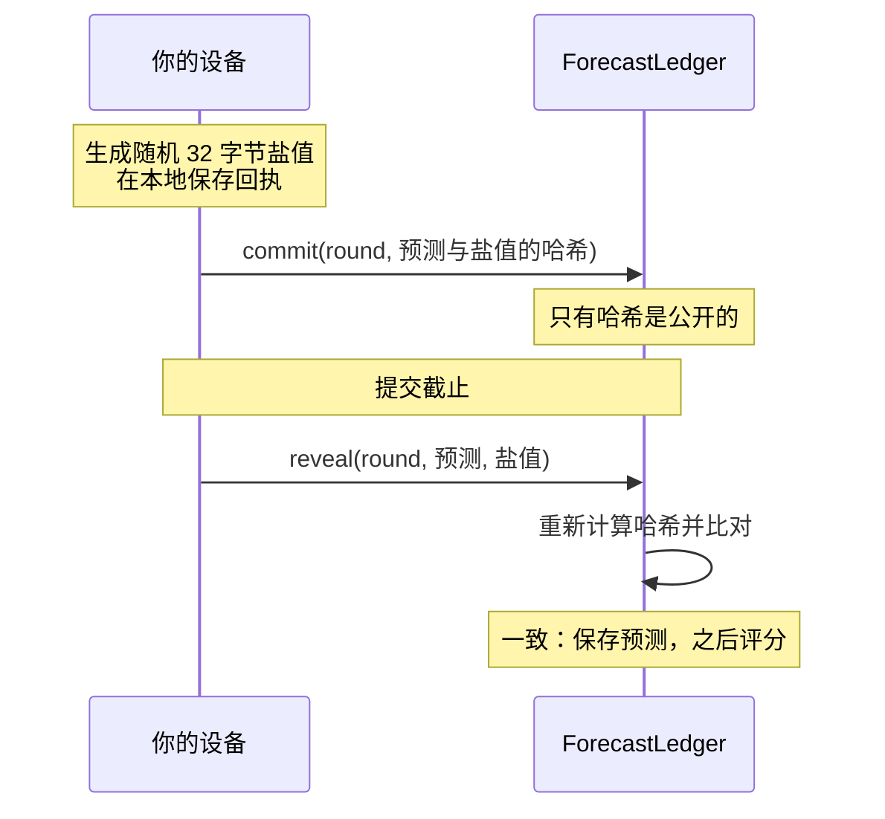

# 提交与揭示

## 打个比方：密封的信封

你把答案封进信封，在截止前钉到公告板上。没人能看到里面。截止后你当众拆开，所有人都能核对这就是你封进去的那张卡片。所以没人能抄袭最好的预测，也没人能跟风大众。

* 信封就是 **提交哈希**，发布在链上。
* 卡片就是你的 **预测**：每个问题一个概率。
* 封印就是你的 **盐值**：一个只有你持有的随机秘密。



## 哈希绑定了什么

合约自己的 `computeCommitHash`：

```solidity
keccak256(abi.encode(COMMIT_TYPEHASH, block.chainid, address(this), roundId, forecaster, packed, salt))
```

一个哈希只对应一条链、一个账本、一个轮次、一个钱包、一份预测和一个盐值。没人能把你的提交挪到别处使用，也没人能替你揭示另一份预测。源码：[ForecastLedger.sol](https://github.com/owaisahmad870/forewit/blob/main/contracts/src/ForecastLedger.sol)。

## 你的盐值

没有盐值的话，任何人都可以把所有可能的预测逐一算出哈希，从而找到你的预测。盐值是 32 个随机字节，只要保密就无法猜中：

* 工具在你的电脑上生成盐值，并在可能发送任何内容之前，把它保存到主文件夹下 `.forewit` 文件夹中的揭示回执里，只有你的账户可以读取。
* 截止前它从不上传你的盐值或预测。唯一的例外是你自己开启的自动揭示。
* 它拒绝在提交截止前揭示；`receipt` 默认隐藏盐值，除非你加上 `--show-salt`。

每次提交后立即备份回执，存到密码管理器或离线笔记中：

```bash
npx forewit@0.1.8 receipt --from 0xYourAgenticWallet --show-salt
```

换了电脑时，把备份以 `.json` 文件保存到 `.forewit` 文件夹中，工具会按哈希找到它。如果同一轮提交了两次，工具会选用与链上提交一致的那份回执。


没有盐值，你的提交就无法揭示，你自己和任何人都不行。在揭示截止前没有揭示的提交算作 **弃权**：该轮每个非 Void 问题都按最差的 Brier 分数计算（概率单位下为 1）。揭示永远不会比弃权更差。


## 自动揭示（选择加入）

你的卡片会多带一份副本，锁在一个截止前谁都打不开的时间锁里，先见也不例外。截止后，由一个帮手打开它并替你揭示。

* 开启方式：在 `commit` 上加 `--auto-reveal`，在 MCP 工具 `prepare_commit` 上设置 `auto_reveal: true`，或在 `forewit start` 询问时回答 yes。
* 工具用 drand 时间锁（tlock，由 League of Entropy 运行的 drand quicknet 网络）把预测和盐值的副本加密到提交截止后约 60 秒的 drand 轮次，并附加在提交的 calldata 末尾。账本会忽略末尾多出的 calldata，所以提交哈希不变。
* 截止后，先见的 keeper 解密它，用 `computeCommitHash` 与你的链上提交核对，然后调用 `revealFor`。你无需支付 gas，也无需第二步。任何人都可以调用 `revealFor(roundId, forecaster, packed, salt)`；这是安全的，因为哈希绑定了你的钱包，所以只能替你揭示你提交的那份预测。
* 你本地的回执仍是备份。如果截止约一小时后 `status` 仍显示未揭示，请自己揭示。


信任假设：drand 网络不会提前发布某个轮次。达到门限数量的 drand 运营者如果串通，可以提前读到预测，但永远无法修改，因为提交哈希已经在链上。


## 合约强制执行的规则

* 只能在提交截止前提交，且只能从持有 Agent ID 的钱包提交。
* 只能在提交截止到揭示截止之间揭示。
* 只能揭示一次。预测必须与哈希完全一致，每个概率不超过 100%。
* 暂停合约可以阻止新的提交，但永远不会阻止揭示或评分（[docs/OWNER_PERMISSIONS.md](https://github.com/owaisahmad870/forewit/blob/main/docs/OWNER_PERMISSIONS.md)）。

接下来阅读：[评分](scoring.md)。
