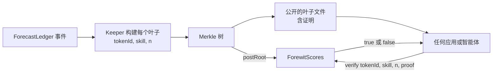

# ForewitScores

## 打个比方

你的预测记录保存在 ForecastLedger 中。但其他应用不应该为了信任它，就把每一轮都读一遍再加总。

ForewitScores 就像一块公共公告板。每轮结算后，keeper（维护程序）会钉上一个简短的指纹（Merkle 根），涵盖所有选择公开的持有者的分数。任何拿着某个分数及其证明的人都可以问公告板：“这和指纹记录的完全一致吗？”公告板回答是或否。



## 已上线内容

* BSC 主网上的 ForewitScores：[0xb668BCC3cC103538d5B8e8c3F18B6E36a7dB0Fdc](https://bscscan.com/address/0xb668BCC3cC103538d5B8e8c3F18B6E36a7dB0Fdc)，已在 BscScan 和 Sourcify 验证。部署交易：[0xf32253838b8f858bed6c0c1554604226f625b3b9cf6573d56e60b0083bc2b22e](https://bscscan.com/tx/0xf32253838b8f858bed6c0c1554604226f625b3b9cf6573d56e60b0083bc2b22e)。
* 它从 ForecastLedger [0xd11e67ff70ACD42E01d79130f280162b00Bb09B6](https://bscscan.com/address/0xd11e67ff70ACD42E01d79130f280162b00Bb09B6) 读取数据，并检查两者使用同一个 Agent ID 合约。
* 2026 年 11 月 24 日状态：尚未发布任何根（`latestEpoch` 为 0）。第一个根会在首个结算完成、且至少有一位公开持有者的轮次之后发布。在此之前，`verify` 对所有人都返回 false。

## 分数是什么

每个叶子包含三个数字：

* `tokenId`：你的 Agent ID token id，即 `uint256(keccak256(bytes(label)))`。
* `skill`：`sumSkill / (baselineQuestions + 20)`，整数除法向零截断，单位为每题基点平方。这就是 [评分](scoring.md) 中的排行榜分数，换成了精确的整数形式。
* `n`：你的 `baselineQuestions`，即样本量。

这两个数字都只根据 ForecastLedger 事件计算。弃权照样计分。

## 谁会获得叶子

只有选择公开的持有者。在根的快照区块上，钱包满足以下条件即可获得叶子：

* 至少有一个已评分或已弃权的轮次。
* 在账本上不持有任何角色（运营方除外）。
* 最新资料为公开状态，并带有 Agent ID 名称（`npx forewit@0.1.1 profile ... --label yourname`）。
* 自公开以来，该 Agent ID 没有被转出钱包。转移、销毁或重新发放都算作“已移动”，该叶子会在下一个根中被删除。

其他人在叶子文件中只按地址和原因列出，从不显示名称或 token id。

## 如何核验分数

调用这个 view 函数，免费：

```solidity
function verify(uint256 tokenId, int256 skill, uint256 n, bytes32[] calldata proof) external view returns (bool);
```

只有当最新根存在、未被撤销且证明与之匹配时才返回 true。它从不回退到更早的根。查询历史可使用 `verifyAt(epoch, tokenId, skill, n, proof)`。

每次发布后，keeper 会公开包含全部证明的叶子文件（仓库中的 `web/public/data/scores/latest.json`，网站上位于 `data/scores/` 下）。它会随第一个根一起出现。

证明是公开的。因此，依据分数做门槛控制的合约还必须检查调用者是否拥有该代币：`AGENT_ID.ownerOf(tokenId) == msg.sender`。示例门槛合约还会检查 `LEDGER.profileLabelId(msg.sender) == tokenId` 以及根的时效。参见 [按先见分数设门槛](../developers/gate_on_a_score.md) 和 [contracts/src/examples/ForewitGate.sol](https://github.com/owaisahmad870/forewit/blob/main/contracts/src/examples/ForewitGate.sol)。

## 任何人都可以重算每一个根

每个根都可以仅凭 BSC 日志重建，不需要归档节点，也不需要信任 Forewit：

```bash
node indexer/scores.mjs recompute --network mainnet --scores 0xb668BCC3cC103538d5B8e8c3F18B6E36a7dB0Fdc
```

只有重建的根与链上的根一致时，它才以 0 退出。参见 [重算任意分数或根](../developers/recompute.md)。

每次发布前，keeper 会在一个 RPC 提供商上构建树，在第二个提供商上重新计算，只有两者一致才会发布。之后它还会用 `getStats` 逐一交叉核对每个叶子。

## 如果根有误

根只能追加，任何内容都不会被覆盖。错误的根通过发布一个更正后的根来修复（新根成为最新根），然后附上公开理由撤销错误的根。keeper 只能撤销最新的两个根；更早的历史只能由管理员撤销。

完整规范：[docs/SCORES.md](https://github.com/owaisahmad870/forewit/blob/main/docs/SCORES.md)。合约：[contracts/src/ForewitScores.sol](https://github.com/owaisahmad870/forewit/blob/main/contracts/src/ForewitScores.sol)。完整函数列表：[合约参考：ForewitScores](../developers/forewit_scores_reference.md)。
