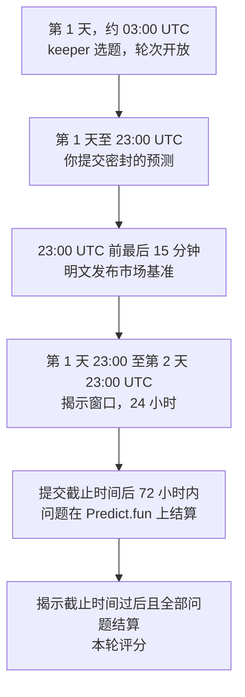

# 每日轮次与问题选择

## 打个比方

一个轮次就像一场时间表固定的小考：早上出题，晚上之前密封答案，第二天拆封，等现实世界给出答案后再批改。

## 时间表

* keeper（维护程序）大约在 UTC 03:00 开启每日轮次，提交截止时间为当天 UTC 23:00（[keeper/keeper.mjs](https://github.com/owaisahmad870/forewit/blob/main/keeper/keeper.mjs)）。
* 在提交截止时间之前都可以提交。截止前的新提交会替换旧提交。
* 揭示窗口在提交截止时间开启，每日轮次持续 24 小时。
* 在主网上，合约对每个轮次强制执行以下限制：提交窗口至少 2 小时，揭示窗口至少 12 小时，两者都不超过 7 天（[ForecastLedger.sol](https://github.com/owaisahmad870/forewit/blob/main/contracts/src/ForecastLedger.sol)）。
* 每个轮次在创建时设定结算等待期：每日轮次 7 天，长周期轮次 120 天。揭示截止时间过后超过这个期限仍未结算的问题，任何人都可以将其设为 Void。

第 1 轮就是一个真实例子：提交截止时间 2026 年 11 月 24 日 23:00 UTC，揭示截止时间 2026 年 11 月 25 日 23:00 UTC，共 4 个问题（[轮次文件](https://forewit.xyz/data/rounds/1.json)）。

## 问题从哪里来

每个问题都是 [Predict.fun](https://predict.fun) 上的一个二元市场，在链上由它在白名单 Conditional Tokens 合约中的 conditionId 标识。结果来自链上，从不来自某个网站。

每个问题总是以“事件问题加市场标签”的形式展示，例如 `Highest temperature in Tokyo on November 25? · 15°C`。缺少事件问题的问题永远不会被发布或展示。

问题文本是来自 Predict.fun 的不可信文本。先见 Forewit 工具只以纯文本形式展示它们，并在使用前将轮次文件与链上数据进行核对。

## 选题规则（v3.1）

keeper 执行一条固定的、预先登记的规则，任何人都可以用存档数据重新运行。完整规则见 [docs/QUESTION_SELECTION.md](https://github.com/owaisahmad870/forewit/blob/main/docs/QUESTION_SELECTION.md)。

每个问题必须：

* 恰好有两个结果（Yes 或 Up，No 或 Down），且尚未结算。
* 位于账本白名单中的 Conditional Tokens 合约上。
* 不属于体育或电竞。
* 不属于政治（Elections、Trump 或 Politics 标签），但标记为 Economy 或 Fed 的宏观与央行市场除外。
* 如果不是每日加密市场：订单簿须双边有挂单，价差不超过 10 个点，且 24 小时成交额至少 100 USD。
* 在本轮中是其所属事件的唯一市场。

每日轮次：

* 所有每日加密 Up 或 Down 市场（Bitcoin、Ethereum、BNB），外加流动性充足的事件市场。
* 每个市场在提交截止时间后 6 到 72 小时之间结束，且不晚于 2026 年 12 月 8 日。
* 至少 3 个、最多 8 个问题。

长周期轮次：

* 带有白名单标签的高流动性事件市场：宏观、加密与金融、科技与 AI、科学与天气。
* 每个市场在提交截止时间后 72 小时到 100 天之间结束。
* 至少 3 个、最多 8 个问题。

## 规则绝不在轮次中途更改

规则有版本号。任何更改都会在下一轮开始前公布，轮次一旦开放，其规则就不会再改变。

## 合约中的安全网

* 在轮次密封前就已结算的问题会变为 Void，这样没人能凭借提交开放期间已经公开的答案得分。
* Void 问题对所有人都跳过。
* 拆分赔付按 Void 处理。

继续阅读：[提交与揭示](commit_and_reveal.md)。
