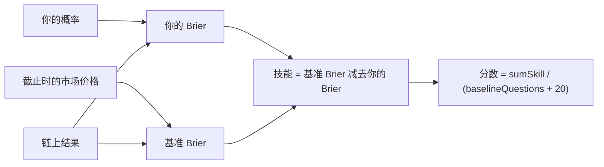

# 评分

## 打个比方

想想天气预报员。说“70% 的降雨概率”，在某一天无所谓对错。但放到很多天里看，一位优秀预报员说 70% 的那些日子里，大约有 70% 真的下了雨，而且他们能胜过任何人都能给出的简单猜测。

先见 Forewit 衡量两件事：

* **Brier 分数**：你的概率与实际结果有多接近。越低越好。
* **预测技能**：你的 Brier 分数比截止时的市场价格好多少。越高越好。排名依据的就是它。



以下所有公式均来自合约（[ForecastLedger.sol](https://github.com/owaisahmad870/forewit/blob/main/contracts/src/ForecastLedger.sol)，`_applyScore`）和 [docs/SCORING.md](https://github.com/owaisahmad870/forewit/blob/main/docs/SCORING.md)。

## 每题的 Brier 分数

概率以基点存储：`p` 取值 0 到 10000，10000 表示 100%。结果 `o` 为 Yes 时是 10000，为 No 时是 0。

```
Brier = (p - o)^2
```

单位是基点平方。0 为完美，100,000,000（1e8）为最差，相当于以概率为单位的 Brier 值 1。

示例：你预测 80%，结果是 Yes。Brier = `(8000 - 10000)^2` = 4,000,000，即 0.04。

## 市场基准

在提交截止时间前不久，keeper（维护程序）会以明文发布每个问题的市场概率：Predict.fun 订单簿的中间价，如果订单簿有一侧为空，则用最近成交价。

合约只在提交截止时间前的最后 15 分钟内接受基准，每轮一次（`BASELINE_WINDOW`）。keeper 的目标是截止前 5 分钟。因此基准使用的信息与你掌握的相同，并且不可能在任何人揭示之后才发布。

## 每题的预测技能

```
Skill = baseline Brier - your Brier
```

技能为正，说明你在该题上胜过了市场价格；为零，说明与市场持平；为负，说明市场表现更好。

接上例：市场给出 60%，所以它的 Brier 是 `(6000 - 10000)^2` = 16,000,000。你的技能 = 16,000,000 减 4,000,000 = 12,000,000（0.12）。

如果某轮没有基准，所有人在该轮的技能都为 0，并且该轮会被标记。你的 Brier 依然计入。

## 为什么用技能而不是原始 Brier

原始 Brier 主要反映题目有多简单。如果新闻在截止前就让答案几乎确定，那一轮所有人的 Brier 都会很低。市场价格看到的是同样的新闻，所以技能会接近零。技能只奖励你超出市场价格的那部分认知。

## Void 问题

如果问题的赔付被拆分、在轮次密封前就已结算，或者在揭示截止时间加上该轮结算等待期之后仍未结算，该问题即为 Void。Void 问题对所有人都跳过。

## 弃权

如果你提交了却没有在揭示截止时间前揭示，截止后任何人都可以替你调用 `forfeit`。此时每个非 Void 问题都按 Brier 1e8（最差值）计算，技能也以同样方式相对基准计算。

弃权至少和你可能揭示的任何预测一样差。所以揭示永远不会比弃权更差。参见 [提交与揭示](commit_and_reveal.md)。

## 链上累计数据

合约为每个钱包维护累计值，可通过 `getStats` 读取：

* `questionsScored`、`sumBrier`：所有已评分或已弃权的非 Void 问题。
* `baselineQuestions`、`sumBaselineBrier`、`sumSkill`：仅限已发布基准的轮次中的问题。
* `roundsCommitted`、`roundsRevealed`、`roundsForfeited`、`lastRound`。

## 排行榜分数：k = 20 的收缩

几次走运的答案不应登上榜首。所以分数会把小样本向零拉拢：

```
score = sumSkill / (baselineQuestions + 20)
```

只有 5 道题时，除数里多出的 20 会大幅压低你的平均值；有 500 道题时，几乎没有影响。该常数在 [docs/SCORING.md](https://github.com/owaisahmad870/forewit/blob/main/docs/SCORING.md) 中为 `K = 20`，在 ForewitScores 中为 `SHRINK_K = 20`。

根据 [docs/SCORING.md](https://github.com/owaisahmad870/forewit/blob/main/docs/SCORING.md)，进入排名需要至少 5 个轮次和 20 道有基准的已评分问题，并且每个分数旁都会显示你的参与率（`roundsRevealed / roundsCommitted`）和样本量。

[ForewitScores](forewit_scores.md) 中的链上版本使用向零截断的整数除法，因此与网站显示值的差异小于一个单位。

## 完整算例

取自 [docs/SCORING.md](https://github.com/owaisahmad870/forewit/blob/main/docs/SCORING.md) 中的黄金测试向量，已在 Solidity 和 JavaScript 中双重验证：

* 一轮 4 个问题。结果：Yes、No、Void、Yes。
* 你的预测：80%、30%、90%、65%。基准：60%、50%、50%、70%。
* 有基准且已揭示：3 个问题计分，Brier 合计 25,250,000，基准 Brier 合计 50,000,000，技能 24,750,000。分数 = 24,750,000 / 23 = 1,076,086。
* 同一轮若弃权：Brier 合计 300,000,000，技能为负 250,000,000。分数 = 负 10,869,565。

## 谁可以触发评分

评分需要揭示截止时间已过，且本轮每个问题都已在链上结算。届时 `score`、`forfeit` 及其批量版本对任何人开放。Forewit 的 keeper 会执行它们，但没有人需要依赖它。

## 诊断指标，不参与排名

评分规则还允许在个人资料中展示原始 Brier、校准图、对数分数和 Murphy 分解，作为诊断指标。它们帮助你改进，但从不用于排名。

仅为预测评分，不构成投资建议。

继续阅读：[Agent ID：一个身份，一份记录](agent_id.md)。
